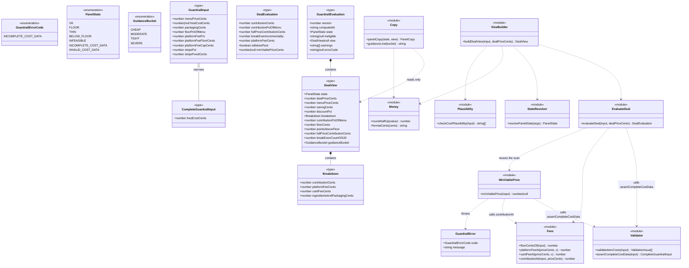
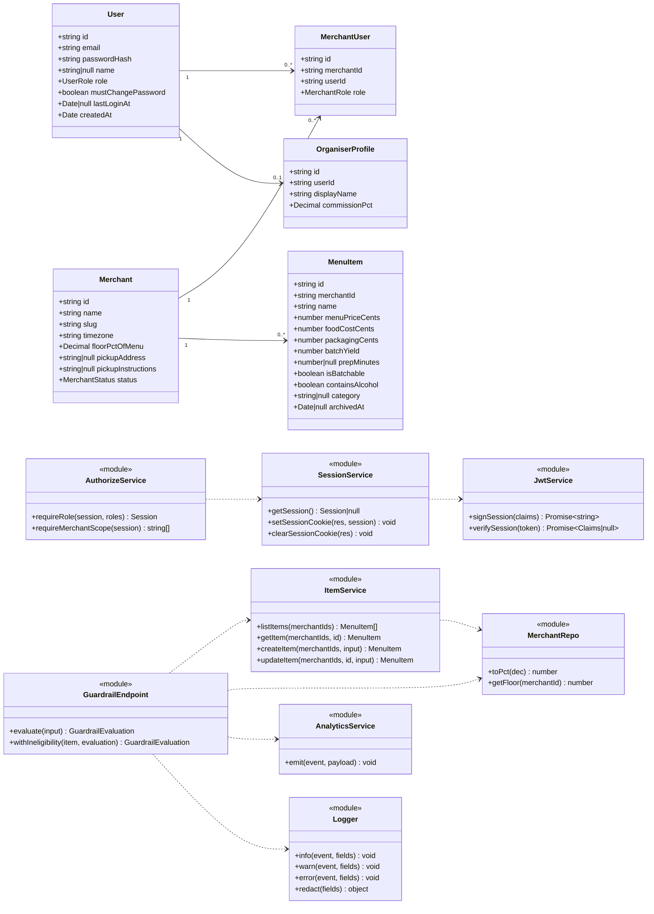
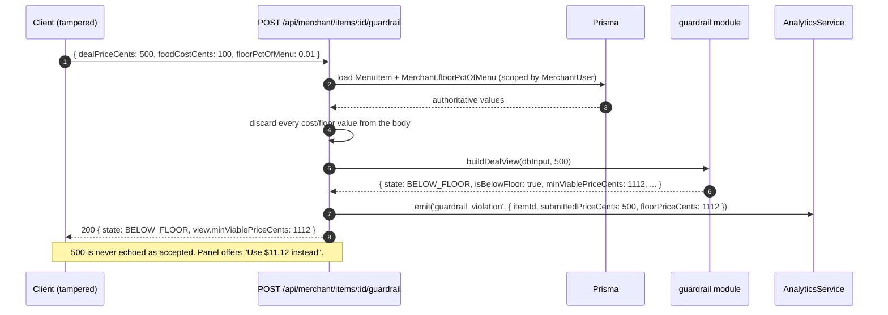
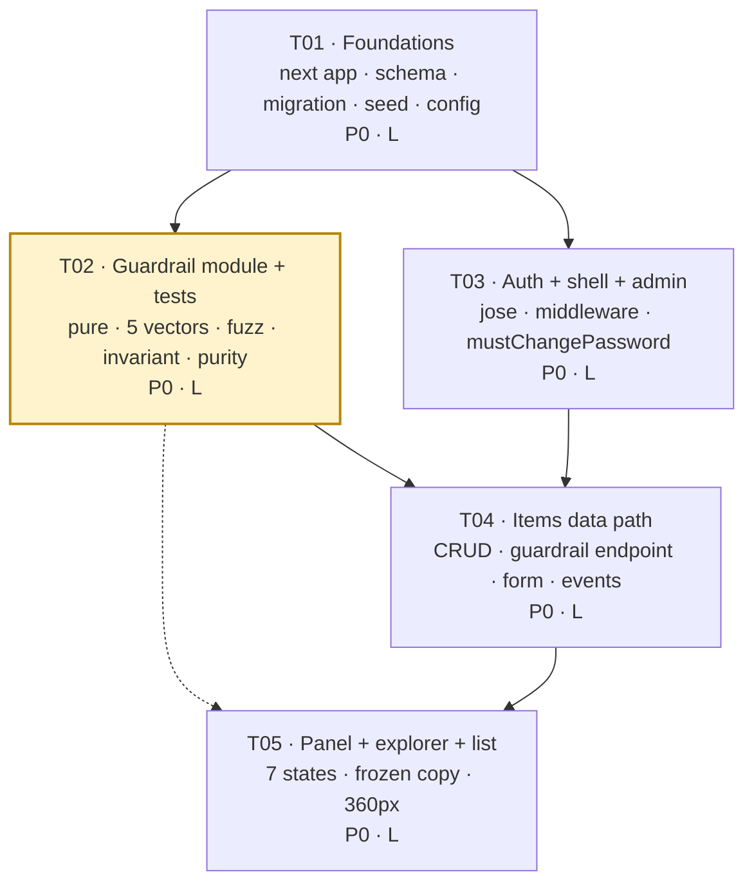

# GroupEat — Sprint 1 Architecture & Task Decomposition (M0 + M1)

**Version:** 1.0
**Date:** 2026-10-28
**Author:** 高见远 (Gao), Architect
**Inputs:** `docs/PRD-sprint1.md` (product source of truth) · `groupeat-strategy/PRD-v1.md` §7 (algorithm, **frozen**)
**Scope:** M0 Foundations + M1 Margin Guardrail. No payments, no AI, no QR, no public pages.

**Precedence:** PRD-v1 §7 wins on arithmetic. PRD-sprint1 wins on scope/copy/data meaning. Where this document appears to change either, this document is wrong.

---

## 1. Implementation approach

### 1.1 The four hard problems, and how each is solved

| # | Problem | Approach |
|---|---|---|
| P-1 | The guardrail must be provably correct and reusable outside this app | One **zero-dependency pure module** at `src/lib/guardrail/`. Its import graph is asserted by a test (AC-8). It never sees Prisma, `next`, React, `fs`, `fetch`, `Date.now()` or `Math.random()`. Everything it needs is passed in. |
| P-2 | "The browser formats, the server computes" must be literally true | The module also produces a **display-ready view** (`DealView`) whose integer cents are guaranteed to sum back to the deal price. The client renders strings from that object and performs no arithmetic on money. |
| P-3 | 7 panel states must be decided by the server, not the client | `resolvePanelState()` lives in the pure module and is unit-tested against the §5.4 precedence table. The API returns `state`; the component switches on it. No state logic in a component. |
| P-4 | Auth must gate three roles and a forced password change, in a Next.js Edge middleware world | `jose` (Edge-safe) for JWT sign+verify in one place. `bcryptjs` for hashing (Node-only, route handlers/server actions only). Middleware does optimistic gate + sliding refresh; `getSession()` re-verifies authoritatively in Node. |

### 1.2 Framework and library selections

| Choice | Reason (one line) |
|---|---|
| **Next.js 15 App Router**, single app at repo root | Mandated by S1-001; API routes and SSR in one process retires the Express split (AC-3). |
| **TypeScript strict** | Money code with no `any` is the cheapest possible insurance. |
| **Prisma 6 + PostgreSQL** | Already in the repo; schema is specified to the column in PRD-v1 §5.1. |
| **Vitest 2** | Native ESM/TS, no Babel chain, works with Next 15 tsconfig paths; the test suite is pure functions so no DOM/jsdom is needed (keeps AC-5…AC-8 fast). |
| **Zod** (boundary only) | One schema drives both the client form and the route handler, so AC-9 cannot drift. **Not** used inside the guardrail folder — that folder has zero imports. |
| **Tailwind CSS v4, no component library** | The 7 states are bespoke copy blocks, not stock components. MUI's emotion runtime complicates RSC and adds ~90 kB to a 360px form. Tailwind keeps NFR-02 honest. *(Deviation from the default MUI stack — see Q-4.)* |
| **`jose`** for JWT | `jsonwebtoken` cannot run in Next.js Edge middleware. Using two JWT libraries would create two verify paths, one of which is never exercised in production. `jose` runs in both runtimes with one implementation. |
| **`bcryptjs`** for hashing | Already a dependency, cost 10 as specified; ported from `groupeat-backend/src/utils/auth.ts`, not rewritten (S1-001). |
| **`tsx`** for `prisma/seed.ts` | `ts-node` is CommonJS-only friction under `"type": "module"`; `tsx` just runs. |
| **JSONL append-only log** for events | S1-017 asks for a local file, not a vendor SDK. No schema delta needed. |

### 1.3 Architecture pattern

Layered, one direction of dependency. The arrow never points backwards:

```
  app/ (RSC pages, route handlers, server actions)
        │  may import
        ▼
  lib/auth · lib/db · lib/analytics · lib/copy · components/
        │  may import
        ▼
  lib/guardrail/  ← pure. Imports NOTHING. Imports nothing from above. Ever.
```

Enforced by `src/lib/guardrail/__tests__/purity.test.ts` (AC-8), which reads every file in the folder and fails on any import specifier that is not relative-and-internal, and on the substrings `next`, `react`, `prisma`, `@prisma`, `fs`, `node:`, `fetch`, `Date.now`, `Math.random`.

---

## 2. File list

Legend: **N** = new · **M** = modified · **D** = delete

### 2.1 Repo root

| Path | | Note |
|---|---|---|
| `package.json` | N | single manifest, replaces `groupeat-backend/package.json` |
| `package-lock.json` | M | regenerated |
| `tsconfig.json` | N | `strict: true`, paths `@/* → src/*` |
| `next.config.ts` | N | |
| `vitest.config.ts` | N | `environment: 'node'`, include `src/**/*.test.ts` |
| `postcss.config.mjs` | N | `@tailwindcss/postcss` |
| `eslint.config.mjs` | N | flat config; `no-console: error` (AC-12), `no-restricted-imports` banning `@/lib/guardrail` from `app/api/**` where not needed |
| `.env.example` | N | every key + comment (S1-007) |
| `.gitignore` | M | add `.env`, `.next`, `var/`, `coverage/` |
| `groupeat-backend/**` | **D** | entire directory: Express server, 7 route modules, `authMiddleware`, old schema, 4 old migrations, `yarn.lock` |
| `groupeat-frontend/**` | **D** | empty, uninitialised submodule |
| `PROJECT_PLAN.md` | **D** | superseded |

### 2.2 Prisma

| Path | | Note |
|---|---|---|
| `prisma/schema.prisma` | N | PRD-v1 §5.1 in full + deltas D-1…D-5; 8 legacy models removed, `Restaurant` removed |
| `prisma/migrations/migration_lock.toml` | N | `provider = "postgresql"` |
| `prisma/migrations/20261028120000_init/migration.sql` | N | **one** migration, generated, then `migrate reset` verified from zero (AC-1) |
| `prisma/seed.ts` | N | 1 admin, 3 merchants, 5 dishes + 3 edge-case dishes (§5.4) |

### 2.3 The pure guardrail module — `src/lib/guardrail/`

| Path | | Contents |
|---|---|---|
| `types.ts` | N | `GuardrailInput`, `CompleteGuardrailInput`, `FeeConstants`, `DealEvaluation`, `DealView`, `GuardrailEvaluation`, `CostWarning`, `ValidationIssue`, `GuidanceBucket`, `IneligibilityReason` |
| `errors.ts` | N | `GuardrailErrorCode`, `GuardrailError` |
| `constants.ts` | N | `DEFAULT_FEES`, `THIN_DISCOUNT_THRESHOLD = 0.10`, `FLOOR_WARN_THRESHOLD = 0.15`, `COST_PLAUSIBILITY`, `PRICE_BOUNDS`, `GUIDANCE_BUCKETS` |
| `money.ts` | N | `roundHalfUp`, `formatCents` (hand-rolled — **no `Intl`**, so snapshots are locale-stable) |
| `fees.ts` | N | `floorCentsOf`, `platformFeeAt`, `cardFeeAt`, `contributionAt` |
| `minViablePrice.ts` | N | `minViablePrice()` — the ascending 1-cent scan, exactly PRD-v1 §7.2 |
| `evaluateDeal.ts` | N | `evaluateDeal()` — exactly PRD-v1 §7.3 |
| `view.ts` | N | `buildDealView()` — display cents that reconcile |
| `states.ts` | N | `PanelState`, `resolvePanelState()` — §5.4 precedence |
| `validate.ts` | N | `validateItemCosts()`, `assertCompleteCostData()` — shared by form, API and seed |
| `plausibility.ts` | N | `checkCostPlausibility()` — the non-blocking food-cost warning |
| `index.ts` | N | barrel; the only entry point anything else may import |
| `__tests__/vectors.test.ts` | N | AC-5: 5 vectors, hard-coded |
| `__tests__/invariant.test.ts` | N | AC-7: null-iff, 1,000 cases |
| `__tests__/fuzz.test.ts` | N | AC-6: 1,000 cases, no NaN/Infinity/negative/exception |
| `__tests__/purity.test.ts` | N | AC-8: import-graph assertion |
| `__tests__/view.test.ts` | N | breakdown reconciles; frozen figures $4.01/$0.89/$1.63/$3.01 |
| `__tests__/states.test.ts` | N | 7-state precedence incl. case C → `THIN` not `FLOOR` |
| `__tests__/validate.test.ts` | N | cost invariant + `INCOMPLETE_COST_DATA` + plausibility bands |

### 2.4 Copy (frozen strings) — `src/lib/copy/`

| Path | | Contents |
|---|---|---|
| `guardrail-copy.ts` | N | `panelCopy(state, view): PanelCopy` — every frozen string from §5.3/§5.5, pure, returns strings only |
| `guidance.ts` | N | `guidanceLine(bucket)` — the 4-line lookup table (§5.3) |
| `__tests__/guardrail-copy.test.ts` | N | AC-10: snapshot all 7 states + the vector-A block verbatim |

### 2.5 Auth — `src/lib/auth/`

| Path | | Contents |
|---|---|---|
| `password.ts` | N | `hashPassword`, `verifyPassword` (bcryptjs, cost 10), `assertPasswordPolicy` |
| `jwt.ts` | N | `signSession`, `verifySession` (jose, HS256) — Edge-safe |
| `session.ts` | N | `getSession()`, `setSessionCookie()`, `clearSessionCookie()`, cookie options |
| `authorize.ts` | N | `requireRole()`, `requireMerchantScope()` → merchantIds reachable from `MerchantUser` |
| `rate-limit.ts` | N | in-memory 10/15min/IP for login (documented non-durable) |
| `index.ts` | N | barrel |
| `__tests__/session.test.ts` | N | sign/verify round-trip, expiry, absolute cap, tampered token |

### 2.6 Infrastructure — `src/lib/`

| Path | | Contents |
|---|---|---|
| `config.ts` | N | Zod-validated env, fails fast (S1-007) |
| `db/prisma.ts` | N | singleton PrismaClient |
| `db/items.ts` | N | merchant-scoped item queries; 404 (not 403) on foreign ids |
| `db/merchants.ts` | N | `toPct()` Decimal→number boundary helper |
| `db/users.ts` | N | user + merchant creation for admin |
| `logging/logger.ts` | N | structured JSON, `redact()`, typed event map, **no PII** (AC-12) |
| `analytics/events.ts` | N | append-only JSONL: `guardrail_evaluated`, `guardrail_violation`, `food_cost_implausible`, `floor_changed` |
| `errors.ts` | N | `AppError` with HTTP status + safe public message |

### 2.7 App — `src/app/`

| Path | | Note |
|---|---|---|
| `layout.tsx` | N | root shell, 360px-safe, `lang="en"` |
| `globals.css` | N | Tailwind entry + tokens |
| `page.tsx` | N | role redirect |
| `not-found.tsx` · `forbidden.tsx` | N | S1-008 |
| `login/page.tsx` · `login/actions.ts` | N | §6.1 |
| `change-password/page.tsx` · `change-password/actions.ts` | N | S1-019 |
| `(merchant)/layout.tsx` | N | role gate + nav |
| `(merchant)/merchant/items/page.tsx` | N | §6.2 list, per-row lowest price (S1-020) |
| `(merchant)/merchant/items/new/page.tsx` | N | §6.3 form |
| `(merchant)/merchant/items/[id]/page.tsx` | N | §6.3 form + panel + explorer |
| `(merchant)/merchant/settings/page.tsx` | N | minimum margin, read-only + gated adjust (§5.1, Q-4/Q-6) |
| `(admin)/layout.tsx` · `(admin)/admin/users/page.tsx` | N | §6.5 |
| `(admin)/admin/merchants/[id]/page.tsx` | N | pickup + floor editor (US-A1, US-A2) |
| `(organiser)/layout.tsx` · `(organiser)/organiser/page.tsx` | N | placeholder (US-O1) |
| `api/auth/login/route.ts` | N | `POST` |
| `api/auth/logout/route.ts` | N | `POST` |
| `api/auth/me/route.ts` | N | `GET` |
| `api/auth/change-password/route.ts` | N | `POST` |
| `api/merchant/items/route.ts` | N | `GET`, `POST` |
| `api/merchant/items/[id]/route.ts` | N | `GET`, `PATCH` |
| `api/merchant/items/[id]/guardrail/route.ts` | N | `POST` — read-only evaluation (S1-013) |
| `api/merchant/settings/route.ts` | N | `PATCH` floor (consequence acknowledgement required) |

### 2.8 Components — `src/components/`

| Path | | Note |
|---|---|---|
| `ui/Button.tsx` · `ui/Field.tsx` · `ui/MoneyInput.tsx` · `ui/Card.tsx` · `ui/Badge.tsx` | N | 5 primitives, no library |
| `AppNav.tsx` · `SignOutButton.tsx` | N | role-aware |
| `guardrail/GuardrailPanel.tsx` | N | switch on `state`; renders `panelCopy()`; **no arithmetic** |
| `guardrail/BreakdownTable.tsx` | N | the reconcile-visible breakdown (§6.4 rule 1) |
| `guardrail/PriceExplorer.tsx` | N | S1-015 slider, hard clamp, no text entry |
| `guardrail/__tests__/panel-copy.test.ts` | N | state → headline/action wiring; greps the component for money arithmetic |
| `items/ItemForm.tsx` | N | client form, blur validation, debounced re-evaluate |
| `items/ItemListRow.tsx` | N | |
| `admin/CreateUserForm.tsx` · `admin/CreateMerchantForm.tsx` · `admin/FloorEditor.tsx` | N | |

### 2.9 Root

| Path | | Note |
|---|---|---|
| `src/middleware.ts` | N | verify + role gate + `mustChangePassword` gate + sliding refresh |

---

## 3. Data structures and interfaces

### 3.1 Guardrail module — complete TypeScript signatures

```ts
// ---------- src/lib/guardrail/types.ts ----------

export type FeeConstants = {
  platformFeePct: number;         // 0.08
  platformFeeFloorCents: number;  // 60
  platformFeeCapCents: number;    // 200
  stripePct: number;              // 0.029
  stripeFixedCents: number;       // 30
};

/** Public input. `foodCostCents` is deliberately widened so partial API/AI input type-checks. */
export type GuardrailInput = FeeConstants & {
  menuPriceCents: number;
  foodCostCents: number | null | undefined;
  packagingCents: number;
  floorPctOfMenu: number;         // 0 < x <= 1
};

/** Post-narrowing shape. Only this one reaches the arithmetic. */
export type CompleteGuardrailInput = FeeConstants & {
  menuPriceCents: number;
  foodCostCents: number;
  packagingCents: number;
  floorPctOfMenu: number;
};

/** PRD-v1 §7.3, field-for-field. This object is what goes into `Drop.guardrailSnapshot.result`. */
export type DealEvaluation = {
  contributionCents: number;
  contributionPctOfMenu: number;
  fullPriceContributionCents: number;
  breakEvenIncrementality: number;
  platformFeeCents: number;
  isBelowFloor: boolean;
  minViablePriceCents: number | null;
};

export type GuidanceBucket = 'CHEAP' | 'MODERATE' | 'TIGHT' | 'SEVERE';

export type IneligibilityReason = 'NOT_BATCHABLE' | 'CONTAINS_ALCOHOL';

/** Display-ready. Every integer here is safe to render as-is. */
export type DealView = {
  state: PanelState;
  menuPriceCents: number;
  dealPriceCents: number;
  savingCents: number;
  discountPct: number;                  // whole percent, half up
  minViablePriceCents: number | null;
  isBelowFloor: boolean;
  breakdown: {                          // INVARIANT: the four sum to dealPriceCents
    contributionCents: number;
    platformFeeCents: number;
    cardFeeCents: number;
    ingredientsAndPackagingCents: number;
  };
  contributionCentsExact: number;       // unrounded, for storage only
  contributionPctOfMenu: number;        // whole percent
  floorPctOfMenu: number;               // whole percent
  floorCents: number;                   // rounded, for the INFEASIBLE sentence
  pointsAboveFloor: number;             // whole points; negative when below
  fullPriceContributionCents: number;   // rounded, may be negative
  breakEvenCountOf100: number;          // 0..100
  guidanceBucket: GuidanceBucket;
};

export type GuardrailWarning =
  | 'FOOD_COST_IMPLAUSIBLY_LOW'
  | 'FOOD_COST_IMPLAUSIBLY_HIGH'
  | 'FLOOR_BELOW_WARN_THRESHOLD'
  | 'COST_DATA_INCOMPLETE';

/** The API response. The only object the UI is allowed to trust. */
export type GuardrailEvaluation = {
  version: 1;
  computedAt: string;                   // ISO-8601 with offset, injected by caller
  state: PanelState;
  ineligible: IneligibilityReason | null;
  input: CompleteGuardrailInput | null; // echoed from DB, never from the request body
  view: DealView | null;
  warnings: GuardrailWarning[];
  errorCode: GuardrailErrorCode | null;
};

export type ValidationIssue = {
  field: 'menuPriceCents' | 'foodCostCents' | 'packagingCents' | 'batchYield' | 'prepMinutes' | 'floorPctOfMenu';
  code: 'REQUIRED' | 'NOT_A_NUMBER' | 'NEGATIVE' | 'TOO_LARGE' | 'COST_EXCEEDS_PRICE' | 'OUT_OF_RANGE';
};
```

```ts
// ---------- src/lib/guardrail/errors.ts ----------
export enum GuardrailErrorCode {
  INCOMPLETE_COST_DATA = 'INCOMPLETE_COST_DATA',   // foodCostCents null | undefined | NaN
}
export class GuardrailError extends Error {
  readonly code: GuardrailErrorCode;
  constructor(code: GuardrailErrorCode, message?: string);
}
```

```ts
// ---------- src/lib/guardrail/states.ts ----------
export enum PanelState {
  OK = 'OK',
  FLOOR = 'FLOOR',
  THIN = 'THIN',
  BELOW_FLOOR = 'BELOW_FLOOR',
  INFEASIBLE = 'INFEASIBLE',
  INCOMPLETE_COST_DATA = 'INCOMPLETE_COST_DATA',
  INVALID_COST_DATA = 'INVALID_COST_DATA',
}
/** §5.4 precedence, first match wins. Exactly one state is returned. */
export function resolvePanelState(args: {
  validationFailed: boolean;         // 1
  costDataIncomplete: boolean;       // 2
  minViablePriceCents: number | null;// 3
  isBelowFloor: boolean;             // 4
  discountPctExact: number;          // 5
  dealPriceCents: number;            // 6
  thinThreshold: number;             // constant, injected
}): PanelState;
```

```ts
// ---------- public API of the folder (index.ts) ----------
export function minViablePrice(input: GuardrailInput): number | null;
export function evaluateDeal(input: GuardrailInput, dealPriceCents: number): DealEvaluation;
export function buildDealView(input: GuardrailInput, dealPriceCents: number): DealView;
export function validateItemCosts(input: {
  menuPriceCents: number; foodCostCents: number | null | undefined;
  packagingCents: number; batchYield: number; prepMinutes?: number | null;
}): ValidationIssue[];
export function checkCostPlausibility(input: CompleteGuardrailInput): GuardrailWarning[];
export function floorCentsOf(input: GuardrailInput): number;
```

**Behavioural contract, stated once:**

| Function | Contract |
|---|---|
| `minViablePrice` | Throws `GuardrailError(INCOMPLETE_COST_DATA)` iff `foodCostCents` is `null`/`undefined`/`NaN`/non-finite. Otherwise scans `P = ceil(menuPrice*0.5) … menuPrice` ascending, 1-cent steps, returns first `P` with `contributionAt(P) >= floorPctOfMenu*menuPriceCents`; else `null`. **Never** throws for a bad cost *relationship* — that returns `null` (§7.4 note). |
| `evaluateDeal` | Same completeness guard. `fullPriceContributionCents = menuPrice − food − packaging − cardFee(menuPrice)` — **no platform fee**, because at full price no GroupEat fee is charged (verified: 1600−480−80−76.4 = 963.60, matching §7.7). |
| `buildDealView` | Rounds `cardFee` and `platformFee` half-up, keeps `food+packaging` integral, then sets `contributionCents = dealPrice − card − fee − ingredients`. Reconciliation is therefore structural, not arithmetic luck. |
| `validateItemCosts` | Returns `[]` when valid. Enforces `menuPriceCents > 0 && <= 50000`, `foodCostCents >= 0`, `packagingCents >= 0`, `foodCostCents + packagingCents < menuPriceCents`, `1 <= batchYield <= 200`, `1 <= prepMinutes <= 240`. **The single source of the cost invariant** — imported by the client form, the route handler and the seed. |
| `checkCostPlausibility` | Warns `FOOD_COST_IMPLAUSIBLY_LOW` when `foodCost < 0.15 * menuPrice`, `FOOD_COST_IMPLAUSIBLY_HIGH` when `foodCost > 0.70 * menuPrice`. **Never blocks.** |

### 3.2 Verified numeric facts (I ran these; the engineer can trust them)

| Check | Result |
|---|---|
| Vector A | `minViable = 1112`, fee 88.96, card 62.248, contribution 400.792, full-price contribution 963.60, break-even 0.7062 → **matches §7.4 and §7.7 exactly** |
| Vector B | `minViable = 410`, contribution 163.11, break-even 0.7366 → **matches** |
| Vector C | `minViable = 1168`, contribution 300.688, break-even 0.5858 → **matches** |
| Vector D | `minViable = null`, contribution at menu −108.10 → **matches** |
| Display rounding (my scheme) | A → 62 / 89 / 560 / **401** (sum 1112); B → 42 / 60 / 145 / **163**; C → 64 / 93 / 710 / **301**. Reproduces the frozen copy figures `$4.01`, `$0.89`, `$1.63`, `$3.01` **and** reconciles to the deal price in every case. |
| Correct invariant, 200,000 random cases | `(minViablePrice === null) ⟺ (contributionAt(menuPrice) < floorCents)` — **0 violations** |
| Worst-case cost (`menuPrice = 50000`) | 1,000 full scans in **1 ms**. No need to optimise; keep the literal loop. |

### 3.3 Class diagram — pure guardrail domain



### 3.4 Class diagram — server, data and auth layer



### 3.5 Schema deltas to apply (all in the one migration)

| ID | Change | Notes |
|---|---|---|
| D-1 | `Merchant.floorPctOfMenu Decimal @default(0.25) @db.Decimal(5,2)` | **P0** |
| D-2 | `MenuItem.containsAlcohol Boolean @default(false)` | **P0** |
| D-3 | `MenuItem.category String?` | P1 |
| D-4 | `User.mustChangePassword Boolean @default(false)`, `User.lastLoginAt DateTime?` | P1 |
| D-5 | `Order.participantId` → relation to `DropParticipant` (`@unique`, `fields: [participantId]`) | P1 |

Deleted models: `DiningGroup`, `GroupMember`, `GroupInvitation`, `Review`, `DishPost`, `DishPostLike`, `DishPostComment`, `UserPreference`, `Restaurant`.
Created-but-unused (must exist, must not be touched): `Customer`, `Drop`, `DropParticipant`, `ShareLink`, `Order`, `LedgerEntry`, `AiDraft`, `ConsentRecord`, and enums `DropStatus`, `AuthStatus`, `ChargeStatus`, `LedgerType`, `ConsentBasis`.

> **Footgun, called out for the engineer:** `Merchant.floorPctOfMenu` comes back from Prisma as a `Decimal` object, not a `number`. It must pass through `MerchantRepo.toPct()` (`Number(dec)`) **before** entering the guardrail. Passing the `Decimal` straight in makes every comparison false and silently returns `null` — i.e. every dish becomes INFEASIBLE and the bug looks like a product decision. There is a test for this.

---

## 4. Program call flow

### 4.1 Flow 1 — Merchant saves a dish and the guardrail evaluates it

```mermaid
sequenceDiagram
autonumber
participant B as ItemForm (client)
participant RH as POST/PATCH /api/merchant/items
participant S as SessionService
participant A as AuthorizeService
participant V as validateItemCosts (pure)
participant I as ItemService
participant DB as Prisma / Postgres
participant G as guardrail module (pure)
participant P as checkCostPlausibility (pure)
participant AN as AnalyticsService
participant L as Logger

B->>B: onBlur: parse "$16.00" -> 1600 (boundary, once)
B->>V: validateItemCosts(values)
V-->>B: [] or issues
alt issues.length > 0
  B-->>B: mark fields, block submit, state INVALID_COST_DATA
else valid
  B->>RH: POST { name, menuPriceCents, foodCostCents, packagingCents, batchYield, prepMinutes, isBatchable, containsAlcohol, category }
  RH->>S: getSession()
  S-->>RH: session | null
  RH->>A: requireRole(session, [MERCHANT])
  A-->>RH: merchantIds[]
  RH->>V: validateItemCosts(body) -- server re-validates, never trusts client
  alt issues.length > 0
    V-->>RH: issues
    RH-->>B: 422 fieldErrors -- AC-9 server half
  else valid
    RH->>I: createItem / updateItem(merchantIds, body)
    I->>DB: INSERT / UPDATE MenuItem WHERE merchantId IN (merchantIds)
    DB-->>I: item
    I-->>RH: item
    RH->>L: info('item.saved', { actorId, itemId, merchantId })
    RH->>G: minViablePrice({ menuPrice, foodCost, packaging, floorPct: toPct(merchant.floorPctOfMenu) })
    alt foodCostCents null/NaN
      G-->>RH: throw GuardrailError(INCOMPLETE_COST_DATA)
      RH->>G: buildDealView(...) -- not reached; state = INCOMPLETE_COST_DATA
    else complete
      G->>G: scan P = ceil(menu*0.5) .. menu
      G-->>RH: 1112 | null
      RH->>G: buildDealView(input, minViable ?? menuPrice)
      G-->>RH: DealView (state, breakdown sums to dealPrice)
    end
    RH->>P: checkCostPlausibility(input)
    P-->>RH: ['FOOD_COST_IMPLAUSIBLY_HIGH'] | []
    RH->>AN: emit('guardrail_evaluated', { itemId, minViablePriceCents, isBelowFloor })
    RH->>AN: emit('food_cost_implausible', { itemId, foodCostCents, menuPriceCents })
    AN-->>L: append JSONL line (no PII)
    RH-->>B: 200 GuardrailEvaluation { version, computedAt, state, view, warnings }
    B->>B: render GuardrailPanel(state) from copy module — formatting only
  end
end
```

### 4.2 Flow 2 — Login, then the forced password change

```mermaid
sequenceDiagram
autonumber
participant U as Browser
participant MW as src/middleware.ts (Edge, jose)
participant L as /login (RSC + server action)
participant AH as POST /api/auth/login
participant PS as password.ts (bcryptjs)
participant DB as Prisma
participant S as SessionService
participant R as rate-limit.ts

U->>L: GET /login
L-->>U: form (one error message for both wrong email and wrong password)
U->>AH: POST { email, password }
AH->>R: hit(ip)
alt > 10 attempts / 15 min
  R-->>AH: blocked
  AH-->>U: 429 (generic)
else allowed
  AH->>DB: findUnique User by lowercased email
  DB-->>AH: user | null
  alt user is null
    AH->>PS: verifyPassword(password, DUMMY_HASH) -- constant-time, no user enumeration
    PS-->>AH: false
    AH-->>U: 401 "Email or password is incorrect."
  else user exists
    AH->>PS: verifyPassword(password, user.passwordHash)
    PS-->>AH: ok
    AH->>DB: update User.lastLoginAt = now()
    AH->>S: signSession({ sub, role, mv: mustChangePassword, absAt: now+7d })
    S-->>AH: token (exp = min(now+60m, absAt))
    AH->>AH: Set-Cookie groupeat_session: httpOnly; SameSite=Lax; Secure(prod); Path=/
    AH-->>U: 303 redirect
  end
end
alt user.mustChangePassword
  U->>MW: GET /merchant/items
  MW->>MW: verifySession (jose)
  MW-->>U: 307 redirect /change-password -- every other route is unreachable
  U->>L: POST /change-password { current, next }
  L->>PS: verifyPassword(current)
  L->>PS: hashPassword(next) (cost 10)
  L->>DB: update User.passwordHash, mustChangePassword = false
  L->>S: re-sign session with mv=false
  L-->>U: 303 redirect by role
else flag clear
  U->>MW: GET /merchant/items
  MW->>MW: verifySession -> { sub, role: MERCHANT, mv: false }
  MW->>MW: role gate: /merchant/* requires MERCHANT
  alt exp - now < 15 min and now < absAt
    MW->>MW: sign fresh token (sliding 60 min, never past absAt)
    MW->>U: 200 + refreshed Set-Cookie
  end
  MW-->>U: page
  U->>DB: (server component) items WHERE merchantId IN (scope from MerchantUser)
end
```

### 4.3 Flow 3 — Tampered price (US-M7, S1-016)



---

## 5. Task list

Five tasks. Ordered by dependency. Each is a functional module, not a file.

---

### T01 — Project foundations: single Next.js app, schema, migration, seed, config

**Priority:** P0 · **Complexity:** L · **Dependencies:** none

**Source files**

| Action | Path |
|---|---|
| D | `groupeat-backend/**`, `groupeat-frontend/**`, `PROJECT_PLAN.md` |
| N | `package.json`, `tsconfig.json`, `next.config.ts`, `vitest.config.ts`, `postcss.config.mjs`, `eslint.config.mjs`, `.env.example` |
| M | `.gitignore`, `package-lock.json` |
| N | `prisma/schema.prisma`, `prisma/migrations/migration_lock.toml`, `prisma/migrations/20261028120000_init/migration.sql`, `prisma/seed.ts` |
| N | `src/lib/config.ts`, `src/lib/db/prisma.ts`, `src/lib/logging/logger.ts`, `src/lib/errors.ts` |
| N | `src/app/layout.tsx`, `src/app/globals.css`, `src/app/page.tsx`, `src/app/not-found.tsx` |

**Acceptance**

- AC-1: `prisma migrate reset --force` on an empty database, zero errors, zero manual steps.
- AC-2: `grep -ri "DiningGroup\|GroupMember\|GroupInvitation\|Review\|DishPost\|DishPostLike\|DishPostComment\|UserPreference\|Restaurant"` returns 0 hits outside `docs/` and git history.
- AC-3: one `package.json` at root, one `next dev`, `npm run build` succeeds, `npm run lint` succeeds.
- S1-007: deleting `JWT_SECRET` from `.env` makes the process exit with a readable message.
- Seed: 1 ADMIN, 3 merchants (Beef Bowl / Latte Bar / Duck House, `floorPctOfMenu = 0.25`, `status = PENDING`), 5 dishes:
  A `$16.00/$4.80/$0.80`, B `$6.50/$1.10/$0.35`, C `$12.00/$6.60/$0.50`, D `$9.00/$8.50/$0.30`, plus `Hand-cut Fries` (`isBatchable = false`) and one `containsAlcohol = true` item and one `foodCost = $0.50 on a $16.00 dish` item (to demo the plausibility warning). Every seeded MERCHANT user has `mustChangePassword = true`.
- `logger.ts` compiles with `no-console` ESLint rule set to `error`.

**Note:** vector E (missing food cost) **cannot** be seeded — `MenuItem.foodCostCents` is non-nullable by design (§8). E lives in the unit test only. See assumption A-2.

---

### T02 — The guardrail module and its full test suite

**Priority:** P0 · **Complexity:** L · **Dependencies:** T01 (for `vitest.config.ts` only; can start day 1)

**Source files**

| Action | Path |
|---|---|
| N | `src/lib/guardrail/{types,errors,constants,money,fees,minViablePrice,evaluateDeal,view,states,validate,plausibility,index}.ts` |
| N | `src/lib/guardrail/__tests__/{vectors,invariant,fuzz,purity,view,states,validate}.test.ts` |
| N | `src/lib/copy/guardrail-copy.ts`, `src/lib/copy/guidance.ts`, `src/lib/copy/__tests__/guardrail-copy.test.ts` |

**Acceptance**

- AC-5: vectors A/B/C/D/E with hard-coded expectations. `1112`, `410`, `1168`, `null`, `throws INCOMPLETE_COST_DATA`. Exact equality, no tolerance on prices.
- AC-6: 1,000 random valid inputs → no `NaN`, no `Infinity`, no negative result, no exception other than `INCOMPLETE_COST_DATA`.
- AC-7: on the same 1,000 cases, `expect(minViablePrice(i) === null).toBe(contributionAt(i, i.menuPriceCents) < floorCentsOf(i))`. **Assert on `contributionCents`, not `fullPriceContributionCents`** — see Q-1.
- AC-8: `purity.test.ts` reads every `.ts` in the folder and fails on any non-relative import, and on `next|react|prisma|@prisma|fs|node:|fetch|Date.now|Math.random`.
- AC-10 (string half): `guardrail-copy.test.ts` snapshots all 7 states and asserts the vector-A block is byte-identical to §5.3.
- Extra: `view.test.ts` asserts the four breakdown rows sum exactly to `dealPriceCents` for all 4 vectors **and** for 1,000 fuzz cases; and that A/B/C display `$4.01`/`$1.63`/`$3.01` and fees `$0.89`/`$0.60`/`$0.93`.
- Extra: `states.test.ts` asserts case C resolves to `THIN`, not `FLOOR`.

**This task alone can fail the sprint.** It is the only task with that property.

---

### T03 — Auth, middleware, app shell and the admin surface

**Priority:** P0 (login) / P1 (admin polish) · **Complexity:** L · **Dependencies:** T01

**Source files**

| Action | Path |
|---|---|
| N | `src/lib/auth/{password,jwt,session,authorize,rate-limit,index}.ts`, `src/lib/auth/__tests__/session.test.ts` |
| N | `src/middleware.ts` |
| N | `src/app/login/{page.tsx,actions.ts}`, `src/app/change-password/{page.tsx,actions.ts}` |
| N | `src/app/api/auth/{login,logout,me,change-password}/route.ts` |
| N | `src/app/(merchant)/layout.tsx`, `src/app/(admin)/layout.tsx`, `src/app/(organiser)/layout.tsx`, `src/app/forbidden.tsx` |
| N | `src/app/(admin)/admin/users/page.tsx`, `src/app/(admin)/admin/merchants/[id]/page.tsx` |
| N | `src/app/(organiser)/organiser/page.tsx` |
| N | `src/components/AppNav.tsx`, `src/components/SignOutButton.tsx`, `src/components/ui/{Button,Field,Card,Badge}.tsx` |
| N | `src/components/admin/{CreateUserForm,CreateMerchantForm,FloorEditor}.tsx` |
| N | `src/lib/db/{users,merchants}.ts` |

**Acceptance**

- AC-4: login works for ADMIN, MERCHANT, ORGANISER; unauthenticated request to `/merchant/items` → `/login`. Post-login redirect `ADMIN → /admin/users`, `MERCHANT → /merchant/items`, `ORGANISER → /organiser`.
- S1-019: with `mustChangePassword = true`, **every** route except `/change-password` and `/api/auth/{me,logout,change-password}` redirects to `/change-password`.
- S1-005: cookie is `httpOnly`, `SameSite=Lax`, `Secure` in production, 60-min sliding, 7-day absolute cap. Verified by `session.test.ts` (a token 8 days old is rejected even if refreshed).
- Role enforcement is in `middleware.ts` **and** re-checked by `requireRole()` in every route handler and layout — middleware is a convenience, not the gate.
- US-A1: creating a merchant yields `status=PENDING`, `floorPctOfMenu=0.25`; attaching an owner creates a MERCHANT user with `mustChangePassword=true` and a `MerchantUser{role:OWNER}`. Duplicate email → field-level error, not 500. Every create writes one `logger.info` line with actor id, entity, entity id.
- US-A2: admin can open any merchant's dish and see the panel + the raw evaluation; the floor field is read-only there.
- US-O1: organiser sees the placeholder copy and cannot reach `/merchant/*` or `/admin/*`.
- AC-12: `no-console` passes; `logger` has no `email`/`phone`/`name` fields in any event type.

---

### T04 — Merchant items: data path, guardrail endpoint, form

**Priority:** P0 · **Complexity:** L · **Dependencies:** T01, T02, T03

**Source files**

| Action | Path |
|---|---|
| N | `src/lib/db/items.ts` |
| N | `src/app/api/merchant/items/route.ts`, `src/app/api/merchant/items/[id]/route.ts`, `src/app/api/merchant/items/[id]/guardrail/route.ts` |
| N | `src/app/api/merchant/settings/route.ts` |
| N | `src/app/(merchant)/merchant/items/new/page.tsx`, `src/app/(merchant)/merchant/items/[id]/page.tsx`, `src/app/(merchant)/merchant/settings/page.tsx` |
| N | `src/components/items/ItemForm.tsx`, `src/components/ui/MoneyInput.tsx` |
| N | `src/lib/analytics/events.ts` |
| N | `src/lib/db/__tests__/items-scope.test.ts`, `src/lib/analytics/__tests__/events.test.ts` |

**Acceptance**

- AC-9: `foodCostCents >= menuPriceCents` is rejected server-side (422 with `fieldErrors`) **and** client-side, with the §5.5 `INVALID_COST_DATA` copy. Same code path (`validateItemCosts`) both sides.
- US-M2: empty ingredient cost blocks with *"We need this. Without it we can't tell you whether a deal makes money."* Valid save persists and the panel appears without a page reload.
- US-M1: merchant A requesting merchant B's item id gets **404, not 403**.
- S1-013: `POST /api/merchant/items/:id/guardrail` accepts only `{ dealPriceCents? }`; recomputes from DB; ignores any `foodCostCents`/`floorPctOfMenu` in the body; never persists; returns `computedAt`.
- S1-016: the item write path calls `validateItemCosts` server-side before any write.
- Lead's addition: `foodCost < 15%` or `> 70%` of menu price → non-blocking warning in the response `warnings[]` **and** one `food_cost_implausible` JSONL line. Never blocks the save.
- S1-017: `guardrail_evaluated` and `guardrail_violation` append one JSONL line each; violation fires when a submitted price is below the floor.
- S1-018: `floorPctOfMenu` read from `Merchant` via `MerchantRepo.toPct()`, never from the body; `PATCH /api/merchant/settings` rejects `<= 0` or `> 1`, and requires `acknowledgedConsequence: true` when lowering. Every change logs `floor_changed { merchantId, from, to, actorId }`.
- `containsAlcohol = true` saves fine but the evaluation returns `ineligible: 'CONTAINS_ALCOHOL'` and no price is ever produced.

---

### T05 — Guardrail panel, price explorer, dish list, and the AC sweep

**Priority:** P0 (panel) / P1 (explorer, list) · **Complexity:** L · **Dependencies:** T02, T04

**Source files**

| Action | Path |
|---|---|
| N | `src/components/guardrail/GuardrailPanel.tsx`, `src/components/guardrail/BreakdownTable.tsx`, `src/components/guardrail/PriceExplorer.tsx` |
| N | `src/components/items/ItemListRow.tsx` |
| N | `src/app/(merchant)/merchant/items/page.tsx` |
| N | `src/components/guardrail/__tests__/panel-copy.test.ts` (copy wiring: state → headline/action) |
| M | `src/app/(merchant)/merchant/items/[id]/page.tsx` (mount panel + explorer) |

**Acceptance**

- AC-10: all 7 states render with the §5.3/§5.5 copy. The component contains **no** `*`, `/`, `Math.` or `toFixed` on money — a grep assertion in `panel-copy.test.ts`.
- AC-11: vector A entered through the UI renders the §5.3 block verbatim: `$11.12 per plate · normally $16.00`, `They save $4.88 (31% off)`, `You keep $4.01 per plate … our fee ($0.89)`, `That's 25% of your menu price — exactly your minimum.`, `71 of every 100 plates`, and the bolded guidance line. Screenshot kept at 360px.
- §6.4 rule 1: the four breakdown rows always add up to the deal price, visibly.
- S1-015: slider left end **is** `minViablePriceCents`; no text input on the slider row; nothing persists.
- S1-020: dish list shows each item's lowest viable price and `You keep $X/plate`; `THIN` rows show a "Thin" badge; `INFEASIBLE` rows show the refusal line; non-batchable rows show "Not batchable — excluded from deals".
- NFR-02: 360px, no horizontal scroll, on all five screens.
- Full AC sweep AC-1…AC-12 green in one `npm run test && npm run build` run.

---

## 6. Packages

```jsonc
// dependencies
"next": "^15.5.0",                    // framework: pages + API routes
"react": "^19.0.0",                   // Next 15 peer
"react-dom": "^19.0.0",
"@prisma/client": "^6.7.0",           // DB access
"zod": "^3.24.0",                     // env + request-body validation at the boundary only
"bcryptjs": "^3.0.2",                 // password hashing, cost 10 (ported, not rewritten)
"jose": "^5.9.0",                     // JWT sign/verify, Edge + Node, one implementation
"server-only": "^0.0.1",              // compile-time guard on lib/auth, lib/db

// devDependencies
"prisma": "^6.7.0",                   // CLI + migrate + generate
"typescript": "^5.8.3",
"@types/node": "^22.15.0",
"@types/react": "^19.0.0",
"@types/react-dom": "^19.0.0",
"@types/bcryptjs": "^3.0.0",
"vitest": "^2.1.0",                   // unit + property tests, node environment
"@vitest/coverage-v8": "^2.1.0",
"tsx": "^4.19.0",                     // runs prisma/seed.ts
"dotenv": "^16.5.0",                  // .env for the seed script (Next loads its own)
"tailwindcss": "^4.0.0",              // styling
"@tailwindcss/postcss": "^4.0.0",
"postcss": "^8.4.0",
"eslint": "^9.0.0",
"eslint-config-next": "^15.5.0",
"typescript-eslint": "^8.0.0"
```

No Stripe, no AI SDK, no mail provider, no SMS, no MUI, no `jsonwebtoken`. Absence is a scope guarantee, not an oversight.

---

## 7. Shared knowledge

### 7.1 Naming

| Thing | Convention |
|---|---|
| Money | always integer cents, field name ends `Cents` (`menuPriceCents`, `savingCents`). Non-integer cents (`contributionCentsExact`) exist **only** on the pure-module result type and are never stored in an `Int` column. |
| Rates | end with `Pct`, value in `0…1` (`floorPctOfMenu = 0.25`), never `25`. |
| Whole percents for display | end with `Pct` on `DealView` only, and the doc comment says "whole percent". |
| Booleans | `is…` / `has…` / `contains…` (`isBatchable`, `containsAlcohol`, `isBelowFloor`). |
| Event names | `noun.verb_past` in logs (`item.saved`, `floor.changed`), `snake_case` in analytics (`guardrail_evaluated`) — matching PRD-v1 §10.1. |
| Guardrail folder | no default exports anywhere. Named only. |

### 7.2 Money and arithmetic rules

1. Parsing happens once, at the boundary, in `MoneyInput` / the route handler: `"$16.00"` → `1600`. Nothing downstream parses a money string.
2. The **only** arithmetic on money outside `src/lib/guardrail/` is in tests. Components format and render.
3. Formatting is `formatCents()` from the pure module (hand-rolled, no `Intl`) → `$11.12`, `-$0.36`. Components import it from `@/lib/guardrail` directly. **There is no `src/lib/money.ts`** — a re-export shim would be a second place to look for the one rounding rule, and the guardrail folder is allowed to be imported by anything.
4. Rounding is half-up, applied only at display: `roundHalfUp(30.5) = 31`, `roundHalfUp(0.7062 * 100) = 71`.
5. `contributionCents` in a stored snapshot is **unrounded** (400.792). `DealView.breakdown` is rounded and reconciles by construction.
6. `Merchant.floorPctOfMenu` is a Prisma `Decimal`. It crosses into a `number` exactly once, in `MerchantRepo.toPct()`.
7. IEEE-754 double arithmetic is used verbatim as in PRD-v1 §7.2. Do **not** introduce rounding or epsilon tolerance into the scan — the frozen vectors were computed that way.

### 7.3 Error handling

| Layer | Convention |
|---|---|
| Pure module | Throws `GuardrailError` with a `GuardrailErrorCode`. One code today: `INCOMPLETE_COST_DATA`. Nothing else throws. |
| Route handler | Catches `GuardrailError` → maps to a `PanelState`, returns **200** with `errorCode` set (an INFEASIBLE dish is a valid answer, not an HTTP error). Validation failures → **422** `{ fieldErrors }`. Auth → **401**. Foreign resource → **404**, never 403. |
| Server component | `redirect()` for auth/role problems, `notFound()` for foreign ids. |
| UI | Never shows a stack trace, a Prisma message, or an error code. Shows the frozen copy for the state. |
| Logging | `logger.error` with an event name and ids only. No `email`, no `phone`, no `name`, no password, no token. AC-12. |

### 7.4 Guardrail error-code semantics

| Code | Meaning | Who produces it | Rendered as |
|---|---|---|---|
| `INCOMPLETE_COST_DATA` | `foodCostCents` is `null`, `undefined`, `NaN` or non-finite | `minViablePrice`, `evaluateDeal` (throw) | `PanelState.INCOMPLETE_COST_DATA`, §5.5 copy |
| *(no code)* | cost relationship is invalid (`food+pack >= menu`) | `validateItemCosts` (issues array) | `PanelState.INVALID_COST_DATA` — **the function is never called** |
| *(no code)* | no price clears the floor | `minViablePrice` returns `null` | `PanelState.INFEASIBLE` |
| *(no code)* | price below floor submitted | `evaluateDeal().isBelowFloor` | `PanelState.BELOW_FLOOR` |

The invalid-cost case is a *validation* outcome, not an exception: PRD-v1 §7.4 requires `minViablePrice` to return `null` for legacy bad data, so the throw is reserved for missing data only.

### 7.5 State precedence (implemented once, in `states.ts`)

`INVALID_COST_DATA → INCOMPLETE_COST_DATA → INFEASIBLE → BELOW_FLOOR → THIN → FLOOR → OK`.
Case C (at the floor *and* 2.7% off) therefore resolves to `THIN`.

### 7.6 Config constants (one home: `src/lib/guardrail/constants.ts`)

| Constant | Value | Note |
|---|---|---|
| `DEFAULT_FEES.platformFeePct` | `0.08` | |
| `DEFAULT_FEES.platformFeeFloorCents` | `60` | |
| `DEFAULT_FEES.platformFeeCapCents` | `200` | |
| `DEFAULT_FEES.stripePct` | `0.029` | |
| `DEFAULT_FEES.stripeFixedCents` | `30` | |
| `THIN_DISCOUNT_THRESHOLD` | `0.10` | Lead decision; review after 20 drops |
| `FLOOR_WARN_THRESHOLD` | `0.15` | US-M5 warning |
| `COST_PLAUSIBILITY.lowRatio` | `0.15` | warning only |
| `COST_PLAUSIBILITY.highRatio` | `0.70` | warning only |
| `PRICE_BOUNDS.menuPriceCents` | `1 … 50000` | |
| `PRICE_BOUNDS.batchYield` | `1 … 200` | |

### 7.7 Test conventions

- Every test lives in `__tests__/` next to the code it tests, named `<subject>.test.ts`.
- `vitest.config.ts` sets `environment: 'node'`. No jsdom, no component-render tests — the panel is tested through `panelCopy()` snapshots, which is why the copy lives in a pure module.
- Pure-module tests import from `@/lib/guardrail` (the barrel) only. That keeps the public surface honest.
- Property tests use a **seeded** PRNG (mulberry32 with a fixed seed) so a failure is reproducible; the fuzz count is exactly 1,000.
- Snapshots are committed. A change to a frozen string must show up as a snapshot diff in review.
- No test touches the database except `items-scope.test.ts`, which runs against a scratch schema and is skipped when `DATABASE_URL` is absent.

### 7.8 Copy ownership

Every merchant-visible string that PRD-sprint1 marks "frozen" lives in `src/lib/copy/`. No frozen string may be typed inline in a `.tsx`. This is what makes AC-10 testable without a browser.

### 7.9 Logging

- `logger.info|warn|error(event, fields)` — structured JSON to stdout.
- Analytics events append one JSON object per line to `ANALYTICS_LOG_PATH` (default `var/analytics/events.jsonl`, git-ignored).
- Both are append-only. The weekly-report reader (M7) reads the JSONL file; nothing in Sprint 1 parses it back.

---

## 8. Open items for the lead

Only items I cannot decide myself.

| # | Item | Why it matters | My recommendation |
|---|---|---|---|
| **Q-1** | **The AC-7 assertion in PRD-sprint1 §5.7 is wrong.** It says `minViablePrice(i) === null` iff `evaluateDeal(i, i.menuPriceCents).fullPriceContributionCents < floorOf(i)`. `fullPriceContributionCents` **excludes the platform fee** (verified: 1600−480−80−76.4 = 963.60, matching §7.7). The correct predicate is `contributionCents` at menu price. I found a concrete counterexample inside the legitimate range: `menuPriceCents = 1000, foodCostCents = 715, packagingCents = 0, floorPctOfMenu = 0.15` → full-price contribution 226 ≥ floor 150, but contribution at menu price 146 < 150, so `minViablePrice` correctly returns `null`. The PM's snippet would fail this case. The prose sentence above the snippet is correct; only the code line is wrong. | If the engineer copies the snippet verbatim, AC-7 fails and it will look like an algorithm bug — someone may then "fix" the frozen algorithm. | **Assert on `contributionCents`.** This changes no formula, no constant, no vector. Ask Xu to correct §5.7's snippet so the document and the test agree. |
| **Q-2** | **Where do `food_cost_implausible` warnings persist?** | The weekly report needs to echo them. | **Append-only JSONL now** (`var/analytics/events.jsonl`), consistent with S1-017 and requiring no schema delta. A `MenuItemCostWarning` table in M7 if the report needs to query rather than replay. Confirm you don't want the table in this migration. |
| **Q-3** | **UI kit: Tailwind only, no MUI.** | Deviates from the default stack in my brief. | Approve. MUI buys nothing for 7 bespoke copy blocks and complicates RSC on a 360px form. If you want MUI, say so now — it changes T03/T05 file lists, not the design. |
| **Q-4** | **JWT library: `jose`, not `jsonwebtoken`.** | S1-001 says "ported, not rewritten" for the auth logic. | Approve `jose`. The *bcrypt* half is ported verbatim; the *JWT* half cannot be, because `jsonwebtoken` does not run in Next.js Edge middleware and two verify paths means one untested path. |
| **Q-5** | **`containsAlcohol = true` items: saveable or unsaveable?** | PRD-sprint1 §7.4 says `true` "blocks the item from any deal, permanently, with no override" but does not say whether the item can exist. | **Saveable, permanently deal-ineligible**, panel shows a hard block with no escape. A merchant needs to record that the item exists in order to see why it is excluded. If you want it rejected at save instead, that is a one-line change in `validateItemCosts`. |

Everything else is decided and written above. Assumptions I made without asking, recorded so they can be overruled cheaply:

- **A-1** — `validateItemCosts` is shared code imported by both the client form and the route handler. PRD-sprint1 §6.3 requires live pre-save feedback on `food+pack < menuPrice`, which is technically arithmetic in the browser; sharing one pure predicate is the only way to satisfy §6.3 and §5.6 simultaneously. Money *figures* still come from the server.
- **A-2** — vector E cannot be seeded (`foodCostCents` is non-nullable, §8). It is a unit-test fixture only. Seed therefore has 4 vector dishes plus 3 edge-case dishes.
- **A-3** — login rate limiting is an in-memory `Map`, single-instance only. Documented; not durable across restarts or instances. Sufficient for a 5-merchant beta.
- **A-4** — the merchant sees `floorPctOfMenu` **read-only** on `/merchant/settings` with the dollar example (US-M5's example line and the <15% warning), and can only change it through the INFEASIBLE escape hatch behind a consequence-naming confirmation (Q-4/Q-6 decisions). The admin can always edit it (US-A1).
- **A-5** — `guardrailSnapshot` is typed as `unknown`/`Json` and never written in Sprint 1; `DealEvaluation` is shaped to be exactly `snapshot.result`, so M3 only has to add the wrapper.

---

## 9. Task dependency graph



**Critical path:** `T01 → T02 → T04 → T05`. `T03` runs in parallel with `T02` after T01 — that is the one genuine parallelisation the two-week window allows.

**Ordering rule the engineer must not violate:** T02 completes and its suite is green before T04 starts. The guardrail is the product; if the UI is built first it will be built around a number nobody has verified. (PRD-v1 §14: "M1 before M3 is not negotiable." The same reasoning applies one step earlier.)

---

## Appendix — Sprint 1 AC coverage map

| AC | Proven by | Task |
|---|---|---|
| AC-1 | `prisma migrate reset --force` in CI | T01 |
| AC-2 | grep sweep | T01 |
| AC-3 | one `package.json`, `npm run build` | T01 |
| AC-4 | manual + `session.test.ts` + middleware gate | T03 |
| AC-5 | `vectors.test.ts` | T02 |
| AC-6 | `fuzz.test.ts` | T02 |
| AC-7 | `invariant.test.ts` (**Q-1 corrected predicate**) | T02 |
| AC-8 | `purity.test.ts` | T02 |
| AC-9 | `validate.test.ts` + route handler 422 test | T02 / T04 |
| AC-10 | `guardrail-copy.test.ts` snapshots + `panel-copy.test.ts` grep | T02 / T05 |
| AC-11 | UI walkthrough at 360px, screenshot | T05 |
| AC-12 | `no-console` lint + logger event map review | T01 / T03 |
