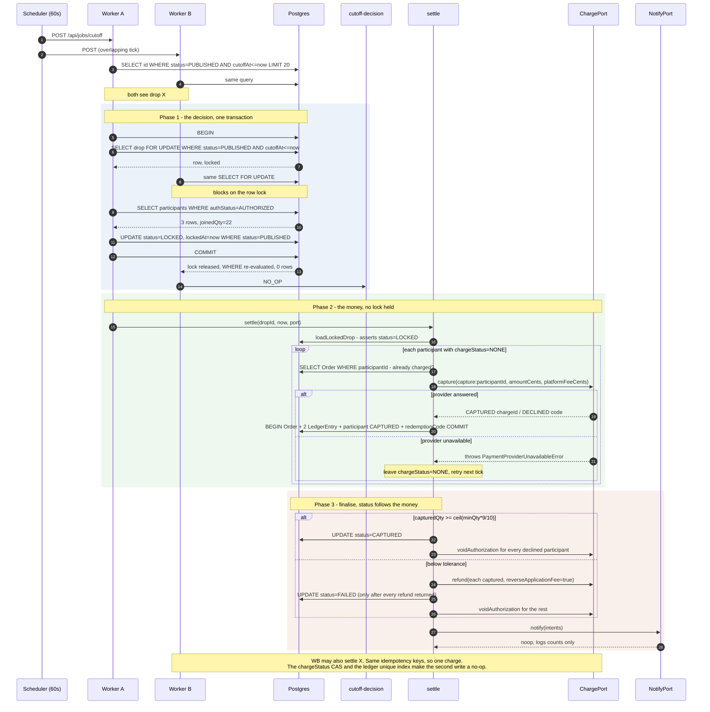
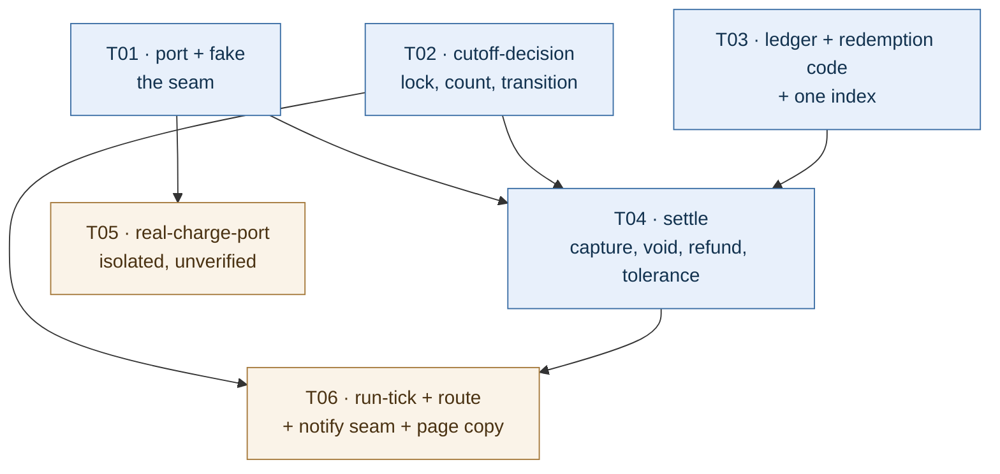

# M5 slice 1 — the cutoff decision and the money-movement seam

**Status:** design for implementation
**Covers:** PRD-v1 §6.5 FR-501…FR-505, FR-507; §8.4; §8.5; §8.7; Appendix A
**Explicitly not covered:** FR-506 delivery (seam only — no SMS provider, `resend` installed but unused), redemption scanning (§6.6, M6), merchant reporting (§6.7, M7), refunds initiated by a merchant or an admin (§8.6 second clause, FR-902/903).
**Reads with:** ADR-001 (direct charges, merchant bears the Stripe fee), ADR-003 (a confirmed drop keeps taking joins to `maxQty`), `CONTRIBUTING.md` (money sentences are type signatures).

Diagrams are inline in this file. `docs/class-diagram.mermaid` and `docs/sequence-diagram.mermaid` belong to ARCHITECTURE-sprint1 and are **not** overwritten.

---

## 1. Implementation approach

### 1.1 The shape: three phases, and why not two

PRD §8.4 describes two phases — decide, then enqueue a capture or void job. This design keeps the decision and splits the second phase in two, because the second phase contains a network call and a network call must not live inside the transaction that holds the row lock:

| Phase | Module | Touches | Duration | Re-entrant? |
|---|---|---|---|---|
| 1. **Decide** | `cutoff-decision.ts` | Postgres only | ~1 ms | yes — row lock + status guard |
| 2. **Move money** | `settle.ts` + `charge-port.ts` | Stripe, one call per participant | up to 20 s each | yes — idempotency keys + CAS writes |
| 3. **Finalise** | `settle.ts` | Postgres + Stripe voids | ~1 ms + N calls | yes — terminal status is the guard |

A single-phase design would hold `SELECT … FOR UPDATE` on the drop row for the duration of *N* Stripe calls. One 20-second timeout would hold the lock for 20 seconds, and a process killed mid-call would hold it until Postgres reaped the connection. Two workers would then serialise behind a lock doing no database work. That is the rejected alternative; it is rejected on latency, not on correctness.

### 1.2 There is no job table. The drop row is the job.

§8.4 asks for a `CaptureJob`/`VoidJob` table keyed by `dropId` with a unique constraint. This design does not add one, and the property §8.4 wants is preserved by a different mechanism:

| §8.4 requirement | Mechanism here |
|---|---|
| "a job exists at most once per drop" | `Drop.status` is a single column with a single value. `LOCKED` *is* the capture job; `FAILED` *is* the void job. There is no second row to duplicate. |
| "the job is resumable after a crash" | `LOCKED` is durable. The next tick re-derives the work from `chargeStatus` per participant. |
| "the job can be locked" | `SELECT … FOR UPDATE` on the drop row. |

Rejected alternative: a `SettlementJob` model. It would need its own status enum, its own idempotency, its own stuck-row reaper, and its own consistency proof against `Drop.status` — four new failure modes to buy a row that duplicates a fact the drop row already holds. If M8's reconciliation needs an attempt log, it can be added then, on evidence.

**One consequence is a real deviation from §8.4 and is recorded here:** "retry with exponential backoff (5 attempts), then raise an admin alert" becomes **"retry on every tick, indefinitely, for retryable failures only; alert when a drop has been `LOCKED` for more than 10 minutes"**. The reason is that §8.4's backoff exists to bound retries of *unclassified* failures. Once failures are classified (§4.2), there is no unbounded retry of a terminal outcome: a declined card is terminal on the first attempt, and only genuinely transient provider errors retry — at 60 s spacing, which is already the backoff. The 10-minute alert threshold is kept verbatim.

### 1.3 Module layout

```
src/lib/settlement/
  charge-port.ts          The seam. Interface, request/result types, the retryable
                          error class. Imports nothing but node types.
  fake-charge-port.ts     Deterministic in-memory port. Dedupes by idempotency key,
                          like Stripe does. Records every call. Test-only, but not
                          under __tests__/ because settle.ts's tests import it and
                          so will M8's reconciliation tests.
  real-charge-port.ts     The only file in this feature that imports `server-only`
                          and the Stripe SDK. Reached by dynamic import only.
  cutoff-decision.ts      Phase 1. `decideFor`, `loadLockedDrop`, and the
                          `LockedDrop` type whose brand is module-private.
  settle.ts               Phases 2 and 3. Capture, void, refund, the 90 %
                          tolerance, finalisation, redemption codes on success.
  ledger.ts               Pure. Builds ledger entries from an order, and computes
                          the per-drop totals the invariant is asserted against.
  redemption-code.ts      FR-505. HMAC-signed code, verifiable offline.
  notify-port.ts          FR-506 seam. Intent types, a noop implementation.
  run-tick.ts             The bounded orchestrator: due drops → decide → settle.
  __tests__/
    fake-charge-port.test.ts
    cutoff-decision.test.ts
    cutoff-decision.concurrency.test.ts
    settle.test.ts
    ledger.test.ts
    redemption-code.test.ts
    run-tick.test.ts
    real-charge-port.live.test.ts   skipped with a named reason; see T05

src/app/api/jobs/cutoff/route.ts   The deployable entry point (POST, bearer-gated).
prisma/schema.prisma               + one unique index on LedgerEntry.
prisma/migrations/<ts>_ledger_idempotency/migration.sql
src/lib/public/drop-view.ts        + `hadCaptures`, so a refunded drop stops saying
                                     "nobody was charged". See §7.
src/lib/public/public-drops.ts     Supplies `hadCaptures` from the Order table.
src/lib/public/__tests__/drop-view.test.ts
src/lib/logging/logger.ts          + the settlement events (§11.7).
```

Why `cutoff-decision.ts` owns the `LockedDrop` brand and not a separate `locked-drop.ts`: the brand is only worth anything if the constructor and the gate are in one file. `settle.ts` imports the type with `import type`, which is erased, so `settle.ts` **cannot construct** a `LockedDrop` — it can only receive one from `decideFor` or `loadLockedDrop`, both of which read a database fact first.

### 1.4 The chain that makes "never charge when the threshold is missed" structural

Not a runtime check in `settle.ts`. A chain of facts, each of which only one module can establish:

```
capture() is called only from captureAll(locked: LockedDrop)
   ↑
LockedDrop is produced only by decideFor() or loadLockedDrop(), both in cutoff-decision.ts
   ↑
decideFor() writes LOCKED only when  now >= cutoffAt  AND  sum(qty WHERE AUTHORIZED) >= minQty
loadLockedDrop() throws unless the row's status is LOCKED, read from Postgres
   ↑
LOCKED is unreachable except through decideFor's guarded UPDATE
```

So the two P0 sentences become:

- **Never charge before the cutoff.** `decideFor` selects `WHERE … cutoffAt <= :now FOR UPDATE`. A drop before its cutoff cannot be selected, therefore cannot be locked, therefore has no `LockedDrop`, therefore cannot be captured. There is a second, independent barrier behind it: a pure guard, `assertCutoffReached({ cutoffAt, now })`, throws `CutoffNotReachedError` on the row the locking select returned. Through the public API that guard is unreachable — the SQL already filtered — so it is exported and tested directly. That is deliberate: it is the assertion that fails loudly if a future edit drops `cutoffAt <= $now` from the `WHERE`, which is the one edit that would silently reintroduce charging before the cutoff.
- **Never charge when the threshold is missed.** That path writes `FAILED`, and `FAILED` has no `LockedDrop`. To capture anyway an engineer would have to add a second constructor to `cutoff-decision.ts` — a change a reviewer sees, rather than a boolean someone forgets to check.

The brand prevents the accident, not the saboteur. The reviewer's job is that `decideFor` and `loadLockedDrop` are the only two producers; a test asserts `settle.ts` exports no function that takes a raw drop row.

---

## 2. The state machine

### 2.1 Every transition this job performs

| # | From | To | Guard (all must hold) | Money movement |
|---|---|---|---|---|
| D1 | `PUBLISHED` | `LOCKED` | `cutoffAt <= now` ∧ `joinedQty >= minQty` ∧ `merchant.stripeAccountId IS NOT NULL` | none yet; capture is now owed |
| D2 | `PUBLISHED` | `FAILED` | `cutoffAt <= now` ∧ `joinedQty < minQty` | none; every live auth must be voided |
| S1 | `LOCKED` | `CAPTURED` | every capture attempt terminal ∧ `capturedQty >= ceil(minQty × 9/10)` | charges stand; declined auths voided |
| S2 | `LOCKED` | `FAILED` | every capture attempt terminal ∧ `capturedQty < ceil(minQty × 9/10)` ∧ every successful capture refunded | captures refunded, fee reversed, remaining auths voided |
| V1 | `FAILED` | `FAILED` | (no transition — void sweep only, idempotent) | void any auth still `AUTHORIZED` |

`joinedQty = SUM(qty) WHERE authStatus = 'AUTHORIZED'` — FR-501, verbatim, and the same predicate `public-drops.ts` already uses for the public count. Excludes `FAILED`, `EXPIRED`, `VOIDED`, `PENDING`.

`capturedQty = SUM(qty) WHERE chargeStatus = 'CAPTURED'` — **units, not people**, because `minQty` is units.

`ceil(minQty × 9/10)` must be computed as `Math.ceil((minQty * 9) / 10)`. `Math.ceil(minQty * 0.9)` happens to agree for every `minQty` in 1…200 (checked), but the tolerance is a business rule and must not depend on a floating-point property that a future change to `PRICE_BOUNDS` could break. One-character cost, removes a class of argument.

### 2.2 The four cases the brief asks about

**Zero participants.** `joinedQty = 0`. `minQty >= 1` is enforced by `validateDropQuantities` at publish, so `0 < minQty` always, so the branch is D2 → `FAILED`. There is no void work (no participant rows), so the drop reaches its terminal state in the same transaction that decides it, with zero external calls and zero ledger rows. This is the cheapest possible correct outcome for the most common failure.

**Already `FAILED`.** `decideFor` selects `WHERE id = :id AND status = 'PUBLISHED' AND cutoffAt <= :now FOR UPDATE`. A `FAILED` row does not match, the select returns zero rows, `decideFor` returns `{ kind: 'NO_OP' }`, nothing is written. The void sweep in `settle` is separately idempotent (it only touches participants whose `authStatus = 'AUTHORIZED'`), so a second tick re-running the sweep for a `FAILED` drop is a no-op that costs one query.

**Already `LOCKED`** (a previous tick decided and crashed before settling). `decideFor` returns `NO_OP`; `runCutoffTick` still asks `settle` about it, because `settle` gates on `loadLockedDrop`, not on the decision. This is why the two phases are separate functions rather than one.

**Already `CAPTURED` or `FAILED`.** `decideFor` returns `NO_OP` (not `PUBLISHED`), and `loadLockedDrop` returns `null` (not `LOCKED`), so `settle` returns `{ kind: 'NOT_LOCKED' }` and touches nothing. This is not an error: a racing tick asking about a drop another tick just finished is the normal outcome of two overlapping invocations, and turning it into a `SettlementIntegrityError` would fill the error log with a non-problem. The guard is the status read, not an exception.

### 2.3 `NO_OP` is deliberately not finer-grained

`decideFor` cannot distinguish "not due yet" from "another worker just took it" without a second, unlocked read whose answer is stale by construction. Both mean *do nothing*, so the return type says `NO_OP` and the tick counts it. A log line that says `noop` is honest; one that says `not_due` when the truth is `raced` would be a lie that costs an hour during an incident.

### 2.4 What the public page says at each state — no contradiction with `resolveDropView`

| Drop status | `resolveDropView` | Page | Consistent? |
|---|---|---|---|
| `PUBLISHED`, cutoff passed, threshold met | `CONFIRMED`, `settling = true` | "Confirmed — N orders. We're charging cards now." | yes — the job has not decided yet |
| `LOCKED` | `CONFIRMED`, `settling = false` | "Confirmed — N orders." | yes, and this is a **shipped, tested** decision (`drop-view.test.ts` "stops settling once the job has locked the drop"). Not changed here. |
| `CAPTURED` | `CONFIRMED` | as above | yes |
| `FAILED` from D2 | `FAILED` | "This drop didn't reach N — nobody was charged." | yes — true |
| `FAILED` from S2 | `FAILED` | **same sentence — false.** Captures happened and were refunded. | **no. Fixed in §7.** |

`settling` is not extended to cover `LOCKED`. It is tempting — cards *are* still being charged while a drop is `LOCKED` — but that flag is defined as "the decision has not been taken", it has a test asserting exactly that, and widening it would make the two `CONFIRMED` sentences indistinguishable during the window they most need to be distinguishable. If in-flight settlement needs a signal, it is a new field, and it is M5's UI slice, not this one. Recorded so the engineer does not "fix" it.

---

## 3. Data structures and interfaces

### 3.1 The port

```ts
// src/lib/settlement/charge-port.ts

export type CaptureRequest = {
  readonly participantId: string;
  readonly dropId: string;
  /** The connected account. The charge lives there, never on the platform (ADR-001). */
  readonly stripeAccountId: string;
  readonly paymentIntentId: string;
  /** Integer cents, gross, read verbatim from DropParticipant.amountCents. */
  readonly amountCents: number;
  /** Integer cents, `application_fee_amount`, read verbatim from the row. */
  readonly platformFeeCents: number;
  /** `capture:${participantId}` — stable across every retry. */
  readonly idempotencyKey: string;
};

export type CaptureOutcome =
  | { readonly status: 'CAPTURED'; readonly chargeId: string }
  | { readonly status: 'DECLINED'; readonly declineCode: string };

export type VoidRequest = {
  readonly participantId: string;
  readonly stripeAccountId: string;
  readonly paymentIntentId: string;
  /** `void:${participantId}` */
  readonly idempotencyKey: string;
};

export type VoidOutcome =
  | { readonly status: 'VOIDED' }
  /** The authorisation had already lapsed. Terminal, and not a failure. */
  | { readonly status: 'ALREADY_EXPIRED' };

export type RefundRequest = {
  readonly participantId: string;
  readonly stripeAccountId: string;
  readonly chargeId: string;
  readonly amountCents: number;
  readonly platformFeeCents: number;
  /**
   * A literal `true`, not `boolean`. Under a direct charge the application fee is
   * NOT refunded automatically — `refund_application_fee` must be passed
   * explicitly (ADR-001 §3.2). Making the field `boolean` would let a caller pass
   * `false` and quietly keep our fee on a drop that never ran. The type refuses.
   */
  readonly reverseApplicationFee: true;
  /** `refund:${participantId}` */
  readonly idempotencyKey: string;
};

export type RefundOutcome =
  | { readonly status: 'REFUNDED'; readonly refundId: string }
  | { readonly status: 'ALREADY_REFUNDED' };

export interface ChargePort {
  capture(request: CaptureRequest): Promise<CaptureOutcome>;
  voidAuthorization(request: VoidRequest): Promise<VoidOutcome>;
  refund(request: RefundRequest): Promise<RefundOutcome>;
}

/**
 * The provider could not answer, or answered "try later". The participant's
 * state is UNKNOWN, which is exactly what an idempotency key is for: the retry
 * returns the original charge instead of making a second one.
 */
export class PaymentProviderUnavailableError extends Error {
  readonly reason: 'timeout' | 'network' | 'http_5xx' | 'rate_limited' | 'unknown';
  constructor(reason: PaymentProviderUnavailableError['reason'], message: string);
}

export function isPaymentProviderUnavailable(
  error: unknown,
): error is PaymentProviderUnavailableError;
```

Two error classes and no third. `CaptureOutcome.status === 'DECLINED'` is **not** an error — a declined card is a normal, expected, terminal outcome (§8.5 expects 2–5 % of them) and modelling it as an exception would make the retry logic have to catch and re-throw it as data. `StripeNotConfiguredError` is imported from `@/lib/payments/connect-port` rather than redeclared: one condition, one class.

### 3.2 The evidence type

```ts
// src/lib/settlement/cutoff-decision.ts

declare const LOCKED_DROP: unique symbol;

export type LockedParticipant = {
  readonly participantId: string;
  readonly qty: number;
  readonly amountCents: number;
  readonly platformFeeCents: number;
  readonly paymentIntentId: string;
  /** E.164. Carried for the FR-506 intent only. Never a log field (see §11.7). */
  readonly phone: string;
};

/** A drop that Postgres said was LOCKED, with its participant set frozen. */
export type LockedDrop = {
  readonly [LOCKED_DROP]: true;
  readonly dropId: string;
  readonly merchantId: string;
  readonly stripeAccountId: string;
  readonly dealPriceCents: number;
  readonly minQty: number;
  readonly maxQty: number;
  readonly cutoffAt: Date;
  readonly decidedAt: Date;
  readonly joinedQty: number;
  readonly participants: readonly LockedParticipant[];
};

export type DecisionOutcome =
  | { readonly kind: 'NO_OP' }
  | { readonly kind: 'LOCKED'; readonly drop: LockedDrop }
  | { readonly kind: 'FAILED'; readonly dropId: string; readonly joinedQty: number };

export async function decideFor(args: {
  dropId: string;
  now: Date;
}): Promise<DecisionOutcome>;

/** The second barrier (see §1.4). Pure, exported so it can be tested directly —
 *  the SQL filter makes it unreachable through `decideFor`, and an untestable
 *  guard is a comment. */
export function assertCutoffReached(args: { cutoffAt: Date; now: Date }): void;

export class CutoffNotReachedError extends Error {
  readonly cutoffAt: Date;
  readonly now: Date;
}

/** `null` when the drop is not LOCKED — including when it is already CAPTURED or
 *  FAILED. Total and idempotent on purpose: a racing tick asking about a drop
 *  another tick just finished is normal, not an error, and must not produce one. */
export async function loadLockedDrop(args: {
  dropId: string;
}): Promise<LockedDrop | null>;

export async function findDueDrops(args: {
  now: Date;
  limit: number;
}): Promise<readonly string[]>;

/** The resume path: drops a previous tick locked but did not finish settling.
 *  Ordered by `cutoffAt` so it uses `Drop_status_cutoffAt_idx`; a drop locked
 *  long ago is the one that needs attention first, and it is also the one the
 *  10-minute stall alert is about. */
export async function findLockedDrops(args: {
  limit: number;
}): Promise<readonly string[]>;
```

`decideFor` returns the `LockedDrop` it just built so the happy path in a single tick needs one participant read instead of two. `loadLockedDrop` exists for the resume path (a `LOCKED` drop from an earlier tick). Both read the same select; they share a private `readParticipants` helper.

### 3.3 Settlement

```ts
// src/lib/settlement/settle.ts

export type SettleOutcome =
  | { readonly kind: 'NOT_LOCKED'; readonly dropId: string }
  | {
      readonly kind: 'IN_PROGRESS';
      readonly dropId: string;
      readonly capturedQty: number;
      readonly pendingParticipants: number;
    }
  | { readonly kind: 'CAPTURED'; readonly dropId: string; readonly capturedQty: number; readonly declinedQty: number }
  | {
      readonly kind: 'FAILED';
      readonly dropId: string;
      readonly reason: 'BELOW_THRESHOLD' | 'BELOW_CAPTURE_TOLERANCE';
      readonly refundedCents: number;
    };

export async function settle(args: {
  dropId: string;
  now: Date;
  port: ChargePort;
  notify?: NotifyPort;
  /** Bounded per tick. Default 50. The rest is picked up next tick. */
  maxParticipants?: number;
}): Promise<SettleOutcome>;

/** Terminal, not retryable: the numbers on the row do not describe a charge we
 *  are willing to make, or the drop is in a state settle() must not touch. */
export class SettlementIntegrityError extends Error {
  readonly dropId: string;
  readonly participantId: string | null;
  readonly check:
    | 'AMOUNT_MISMATCH'
    | 'MISSING_PAYMENT_INTENT'
    | 'MISSING_STRIPE_ACCOUNT'
    | 'LEDGER_MISMATCH';
}
```

### 3.4 A ledger entry, and the order it hangs off

`LedgerEntry` already exists and is unused. Its shape is unchanged; this design only pins down what gets written into it.

```ts
export type LedgerEntryShape = {
  orderId: string | null; // the Order row for a capture; null for a drop-level adjustment
  dropId: string;
  type: 'CHARGE' | 'REFUND' | 'PLATFORM_FEE' | 'ORGANISER_COMMISSION' | 'ADJUSTMENT';
  amountCents: number; // signed. See §6.2.
  stripeRef: string | null; // charge id, refund id, or application-fee id
  note: string | null; // 'capture' | 'refund' | 'application_fee_reversed'
};
```

| Event | Rows written | `amountCents` | `note` |
|---|---|---|---|
| one participant captured | `CHARGE` | `+order.subtotalCents` | `capture` |
| | `PLATFORM_FEE` | `+order.platformFeeCents` | `capture` |
| one participant refunded | `REFUND` | `−refundedCents` | `refund` |
| | `ADJUSTMENT` | `−order.platformFeeCents` | `application_fee_reversed` |
| threshold missed (D2) | none | — | nothing was charged, so there is nothing to record |
| below tolerance (S2) | `REFUND` + `ADJUSTMENT` per captured order | as above | as above |

`ORGANISER_COMMISSION` is **not** written in this slice. Commission is 5 % of captured GMV (FR-804) and is a payout calculation, not a movement of money at capture time; writing it now would put a liability in the ledger before anything pays it. It is M7's, and the reconciliation identity below is written so that adding it later does not break.

### 3.5 The notification intent

```ts
// src/lib/settlement/notify-port.ts

export type NotifyIntent =
  | {
      kind: 'DROP_CONFIRMED_CHARGED';
      dropId: string;
      participantId: string;
      phone: string;
      /** What the diner's card was debited. Gross. See §11.1. */
      chargedCents: number;
      qty: number;
      redemptionCode: string;
      windowStart: Date;
      windowEnd: Date;
    }
  | { kind: 'DROP_CONFIRMED_CARD_DECLINED'; dropId: string; participantId: string; phone: string; qty: number }
  | { kind: 'DROP_FAILED_NO_CHARGE'; dropId: string; participantId: string; phone: string; qty: number }
  | { kind: 'DROP_FAILED_REFUNDED'; dropId: string; participantId: string; phone: string; chargedCents: number; qty: number }
  /** ADR-003's copy obligation. Emitted by the JOIN path when minQty is first
   *  crossed — not by this job. The type exists so the obligation is visible. */
  | { kind: 'THRESHOLD_REACHED_STILL_FILLING'; dropId: string; participantId: string; phone: string; qty: number; cutoffAt: Date };

export interface NotifyPort {
  /** Must never throw into the settlement path. Failure to notify is not failure
   *  to charge, and conflating them would strand a settled drop in LOCKED. */
  notify(intents: readonly NotifyIntent[]): Promise<void>;
}

export function noopNotifyPort(): NotifyPort;
```

`noopNotifyPort` logs `notification.intent` with `{ kind, dropId, count }` only — no phone, no code. That is enough to prove the seam fires, and it is the whole of FR-506 in this slice.

`THRESHOLD_REACHED_STILL_FILLING` is included deliberately: ADR-003 §3 records that the confirmation message "must say 'still filling until {cutoff}'", and that obligation currently has nowhere to live. Putting the kind in the type now means the join path's author inherits it instead of rediscovering it. No emitter exists in this slice, and the doc comment says so.

---

## 4. The concurrency mechanism, exactly

### 4.1 Phase 1, in one transaction

```sql
-- outside the transaction: which drops are candidates. Uses Drop_status_cutoffAt_idx.
SELECT id FROM "Drop"
WHERE status = 'PUBLISHED' AND "cutoffAt" <= $now
ORDER BY "cutoffAt" ASC
LIMIT $limit;
```

```sql
-- inside $transaction: the lock and the status guard are ONE statement.
SELECT id, "merchantId", "dealPriceCents", "minQty", "maxQty", "cutoffAt"
FROM "Drop"
WHERE id = $id AND status = 'PUBLISHED' AND "cutoffAt" <= $now
FOR UPDATE;
```

Zero rows → `NO_OP`. This is the whole concurrency story and it is worth being precise about why:

In `READ COMMITTED` (Prisma's default), when `SELECT … FOR UPDATE` blocks on a row another transaction is updating, Postgres waits for the lock, then **re-evaluates the `WHERE` clause against the newly committed row version** (EvalPlanQual). If the predicate no longer holds — because the other worker already moved the drop to `LOCKED` — the row is not returned. So the status guard is not a separate `if` after the lock; it is part of acquiring the lock. Two workers cannot both get a row.

```sql
-- still inside the transaction, still under the drop lock.
SELECT p.id, p.qty, p."amountCents", p."platformFeeCents",
       p."paymentIntentId", c.phone
FROM "DropParticipant" p
JOIN "Customer" c ON c.id = p."customerId"
WHERE p."dropId" = $id AND p."authStatus" = 'AUTHORIZED';
```

Then `joinedQty = Σ qty`, and:

```sql
UPDATE "Drop" SET status = 'LOCKED', "lockedAt" = $now
WHERE id = $id AND status = 'PUBLISHED';   -- expect exactly 1 row
```

or the `FAILED` equivalent. `count !== 1` throws: under the lock it is unreachable, so a zero there means the lock was dropped from the code, and that must be loud rather than silent.

Two implementation notes that will otherwise cost a round trip:

- **Every query inside the transaction must use `tx`, never the global `prisma`.** A read through the global client runs on a different pooled connection, outside the transaction, and does not see the lock. The design would still be correct for the *transition* (the `UPDATE` is guarded) but the count would be read outside the lock, which is the exact race the lock exists to prevent.
- **Cast the enum parameter.** `$queryRaw` sends parameters as text; write `status = $1::"DropStatus"` (or inline the literal) so Postgres does not have to infer the enum from context.

**Lock ordering.** Drop row first, participants second, always, in that order, in every module. Nothing in this feature takes them in the other order, so no deadlock is constructible. Written down because the join path (not built) must obey the same order.

### 4.2 Phase 2 — what happens when two workers settle the same drop

Three independent guards, deliberately redundant because this is money:

1. **The port call is idempotent.** Both workers send `capture:{participantId}`. Stripe returns the *same* charge to the second caller; it does not make a second one.
2. **The database write is a compare-and-swap.** `updateMany({ where: { id, chargeStatus: 'NONE' }, data: { chargeStatus: 'CAPTURED', … } })`. The loser writes 0 rows.
3. **The ledger cannot double-post.** `@@unique([orderId, type])` (new, §5). A second `CHARGE` row for the same order is a database error, not a second entry.

Rejected alternative: add `ChargeStatus.CAPTURING` and claim the row before calling Stripe, so a worker owns a participant exclusively. It needs a migration, and it needs a reaper for rows stuck in `CAPTURING` after a crash — a new stuck state, to avoid a duplicate call that the idempotency key already makes harmless. Rejected on complexity, and the residual behaviour (two in-flight calls, one charge) is correct.

**The one window that remains, stated plainly.** A worker captures successfully at Stripe and dies before the database write commits. The row still says `chargeStatus = 'NONE'`. The next tick re-captures with the same idempotency key and Stripe returns the original charge — **for 24 hours**, which is how long Stripe retains idempotency keys. Beyond 24 hours a re-capture would create a second charge. Mitigation, in `settle.ts`: before calling the port, look for an existing `Order` with that `participantId` (`Order_participantId_key` is unique). If one exists, the charge already happened — repair `chargeStatus` to `CAPTURED`, read `stripeChargeId` from the order, and skip the port call entirely. That closes the window for any retry, not just a retry inside 24 hours. The only unrecoverable case left is "charge created at Stripe, no `Order` row, and no tick for 24 hours", which the M8 reconciliation job is for; this design does not claim to close it, and the doc comment in `settle.ts` must say so.

### 4.3 What one tick does, in order

```
runCutoffTick({ now, port, notify, maxDrops = 20, maxParticipants = 50 }):
  1. resume  := findLockedDrops(maxDrops)          -- locked by an earlier tick
  2. due     := findDueDrops(now, maxDrops)        -- candidates for the decision
  3. for id of due:
       outcome := decideFor({ dropId: id, now })   -- may write LOCKED or FAILED
       if outcome.kind === 'LOCKED' → add id to resume
  4. for id of new Set(resume):                    -- deduped: a drop decided this
       settle({ dropId: id, now, port, notify, maxParticipants })   -- tick appears
  5. for id of resume: check staleness → settlement.stalled if lockedForMs > 10min
```

Step 4 must dedupe. A drop locked in step 3 also satisfies step 1's query on the *next* tick, and without a `Set` a single tick would settle it twice — harmless for the money (all three guards in §4.2 hold) but it would emit every notification intent twice and log a spurious `NOT_LOCKED`. Dedupe is one `Set`, not a lock.

### 4.4 Bounded per tick

`runCutoffTick` processes at most `maxDrops` (default 20) drops and `maxParticipants` (default 50) participants per drop per invocation. Everything is resumable, so making progress beats finishing: a 60-second cron that tries to settle 400 participants will be killed at the function timeout mid-loop, which is safe but wasteful. A tick that hits the bound logs `settlement.batch_truncated` and returns; the next tick continues.

### 4.5 The order of operations, because status is a claim

**Never advance a status ahead of the money it asserts.** Concretely:

- `CAPTURED` is written only after every participant's capture attempt is terminal.
- `FAILED` from S2 is written only after **every refund has succeeded**. A `FAILED` drop is publicly visible as "everyone who paid has been refunded" (§7); writing it before the refunds land makes the page lie for as long as the refund takes — and permanently, if the refund fails and nobody retries.
- Therefore: a refund that fails retryably leaves the drop in `LOCKED`, and the next tick tries again. `LOCKED` is the only honest state for "money is in flight".

---

## 5. Schema change

One index, no columns, no enum members:

```prisma
model LedgerEntry {
  // …
  @@unique([orderId, type])
  @@index([dropId])
}
```

```sql
CREATE UNIQUE INDEX "LedgerEntry_orderId_type_key" ON "LedgerEntry"("orderId", "type");
```

Postgres treats `NULL`s as distinct in a unique index, so drop-level rows (`orderId IS NULL`) are unconstrained, which is what we want. Consequence to state in the model comment: **V1 permits at most one `CHARGE`, one `PLATFORM_FEE`, one `REFUND` and one `ADJUSTMENT` per order.** A second partial refund on the same order would violate this and needs a deliberate schema decision, not a `try/catch`. §8.6 and FR-903 are one-off full/partial refunds, so this holds; the constraint is the thing that will notice if that changes.

Deliberately not added: FKs from `LedgerEntry.orderId`/`dropId`. They are nullable, they have no relation today, and adding them is a wider migration than this slice needs. The unique index gives the idempotency; referential integrity can arrive with M8's reconciliation, when someone will have a reason to join on it.

---

## 6. The ledger invariant, stated precisely

### 6.1 §8.7 as written cannot be satisfied, and this is not a bug in the code

> `SUM(LedgerEntry.amountCents) == Stripe net balance change for that drop`

Under a direct charge (ADR-001) one drop moves money on **two** Stripe accounts, in two directions:

| Account | Delta for a drop of N units at P, fee F per unit | Which Stripe object proves it |
|---|---|---|
| connected account (merchant) | `+ N·P − cardFee − N·F` | `balance_transaction` on the charge |
| platform | `+ N·F` | `application_fee` balance transaction |

`cardFee` is Stripe's number, we never compute it into our books, and it is not in any ledger column. So there is no single sum of our entries that equals either delta, let alone both. A single-sum invariant is satisfiable only under a destination charge, which ADR-001 rejected.

**Resolution used here: two identities, each reconciled against a named Stripe surface.** Proposed ADR-004 restates §8.7; the PRD is not edited.

### 6.2 Sign convention

**Positive = money arrived. Negative = money left.** Every entry is denominated in the account named by its `type`:

| Type | Account | Sign |
|---|---|---|
| `CHARGE` | connected account, from the diner | `+` |
| `REFUND` | connected account, back to the diner | `−` |
| `PLATFORM_FEE` | platform, from the connected account | `+` |
| `ADJUSTMENT` | platform, when an application fee is reversed | `−` |
| `ORGANISER_COMMISSION` | platform, paid out | `−` (not written in this slice) |

### 6.3 The two identities, and what asserts them

```ts
// src/lib/settlement/ledger.ts — pure, no I/O

export type LedgerTotals = {
  /** Σ CHARGE. What diners were charged. */
  readonly chargedCents: number;
  /** |Σ REFUND|. What went back. */
  readonly refundedCents: number;
  /** Σ (PLATFORM_FEE + ADJUSTMENT). GroupEat's revenue net of reversals. */
  readonly platformFeeCents: number;
  /** chargedCents − refundedCents. */
  readonly capturedGrossCents: number;
};

export function dropLedgerTotals(entries: readonly LedgerEntryShape[]): LedgerTotals;

/** Throws SettlementIntegrityError('LEDGER_MISMATCH') with both sides in the message. */
export function assertLedgerReconciles(args: {
  dropId: string;
  entries: readonly LedgerEntryShape[];
  orders: readonly { id: string; subtotalCents: number; platformFeeCents: number; refunded: boolean }[];
}): void;
```

| # | Identity | Reconciled against |
|---|---|---|
| L1 | `chargedCents − refundedCents == Σ order.subtotalCents where !refunded` | the `Order` rows — our own record of what we charged |
| L2 | `platformFeeCents == Σ order.platformFeeCents where !refunded` | the `Order` rows |
| L3 | `refundedCents == Σ order.subtotalCents where refunded` | the `Order` rows |
| L4 | per order: `CHARGE.amountCents == order.subtotalCents` and `PLATFORM_FEE.amountCents == order.platformFeeCents` | the order it hangs off |
| L5 *(M8, needs Stripe)* | `chargedCents − refundedCents + (card fees) == connected-account balance delta`; `platformFeeCents == Σ application_fee` | Stripe balance transactions |

L1–L4 are checkable in this slice, in-process, with no provider. L5 needs Stripe and is M8's nightly job; this design leaves the function shape (`assertLedgerReconciles`) so L5 is an added input, not a rewrite.

### 6.4 The test that proves the sum

`settle.test.ts`, against real Postgres with `fakeChargePort()`:

> A drop with `dealPriceCents = 1112`, `minQty = 5`, and three participants of qty 2, 1, 3 (`amountCents` 2224 / 1112 / 3336, `platformFeeCents` 178 / 89 / 267 — `roundHalfUp(platformFeeAt(1112)) = 89`, times qty).
> After `settle`, assert, reading only from the database:
> `dropLedgerTotals(entries).chargedCents === 6672`
> `…platformFeeCents === 534`
> `Σ order.subtotalCents === 6672` and `Σ order.platformFeeCents === 534`
> `Σ participant.amountCents === 6672`
> and `assertLedgerReconciles` does not throw.
> Then a second variant where one participant is declined and the drop falls below tolerance: `refundedCents === chargedCents`, `platformFeeCents === 0`, `capturedGrossCents === 0`, and the drop is `FAILED`.

The point of asserting four different ways to reach 6672 is that a rounding change in one of them (per-unit vs per-order, `roundHalfUp` vs `Math.round`) breaks exactly one of the four and the test names which. That is the failure mode `CONTRIBUTING.md` is about.

---

## 7. The one shipped sentence this slice falsifies

`drop-view.ts`'s `headlineFor` says, for any `FAILED` drop:

> "This drop didn't reach {minQty} — nobody was charged."

Under S2 (FR-504, §8.5) that sentence becomes false: the drop *did* reach `minQty`, cards *were* charged, and they were refunded. FR-306's requirement is that the page be explicit about whether money moved; saying "nobody was charged" when everyone was charged and refunded is the opposite of explicit.

Minimal fix, no schema change — the fact is derivable from `Order`:

1. `DropViewInput` gains `hadCaptures: boolean` (**optional, defaulting to `false`**, so every existing call site and every existing test compiles and passes unchanged).
2. `public-drops.ts` supplies it: `orders: { select: { id: true }, take: 1 }` in `PUBLIC_SELECT`, `hadCaptures: row.orders.length > 0`.
3. `headlineFor` gains the branch:

```
FAILED && hadCaptures  → "This drop didn't run — we couldn't charge enough cards, so everyone who paid has been refunded in full."
FAILED && !hadCaptures → "This drop didn't reach {minQty} — nobody was charged."   (unchanged)
```

Wording needs the owner's sign-off (open question 2). The sentence contains a monetary claim ("refunded in full") and is therefore a type signature under `CONTRIBUTING.md`: it must stay true, which is why §4.5 requires refunds to complete before `FAILED` is written.

---

## 8. Sequence — one tick, two workers



---

## 9. Task list

Ordered so the money-critical core lands before the edges. T01 and T02 are independent and can be built in parallel; everything else has a real dependency.

### T01 — The money seam: port, fake, error taxonomy
**Priority:** P0 · **Depends on:** nothing
**Files:** `src/lib/settlement/charge-port.ts`, `src/lib/settlement/fake-charge-port.ts`, `src/lib/settlement/__tests__/fake-charge-port.test.ts`

The interface exists before anything calls it, so T04 is written against a fixed shape and the fake is written against the same shape, and neither can drift toward "what Stripe happens to return".

**Acceptance**
- `npm run typecheck` clean; no `stripe` import in either file.
- Calling `fakeChargePort().capture(req)` twice with the same `idempotencyKey` returns the same `chargeId` both times, and `calls.length === 2` — the fake models Stripe's dedupe, so the retry tests in T04 are meaningful.
- `declineParticipantIds` produces `{ status: 'DECLINED', declineCode }` and does **not** throw.
- `unavailableOnceFor` throws `PaymentProviderUnavailableError` on the first call and succeeds on the second.
- A `RefundRequest` literal with `reverseApplicationFee: false` fails to compile (a `// @ts-expect-error` line in the test proves it).

### T02 — The decision: lock, count, transition
**Priority:** P0 · **Depends on:** nothing
**Files:** `src/lib/settlement/cutoff-decision.ts`, `src/lib/settlement/__tests__/cutoff-decision.test.ts`, `src/lib/settlement/__tests__/cutoff-decision.concurrency.test.ts`

**Acceptance** (DB-backed, real Postgres, fixtures created and torn down in the file, following `draft-validation.test.ts`)
- `PUBLISHED`, cutoff in the past, 3 `AUTHORIZED` participants summing 22 units, `minQty = 20` → `{ kind: 'LOCKED' }`, DB status `LOCKED`, `lockedAt` non-null, `drop.joinedQty === 22`.
- `joinedQty = 19` → `{ kind: 'FAILED' }`, status `FAILED`, `lockedAt` null, and **zero** `Order` and `LedgerEntry` rows.
- Zero participants → `FAILED`, no throw.
- `now = cutoffAt − 1 ms` → `NO_OP`, status still `PUBLISHED`, `lockedAt` null, no participant read performed. Separately, `assertCutoffReached({ cutoffAt, now })` throws `CutoffNotReachedError` when `now < cutoffAt` and returns when `now === cutoffAt` — the exact boundary, tested directly because the SQL makes it unreachable through `decideFor`.
- A `FAILED` drop and a `CAPTURED` drop → `NO_OP`, no write (`lockedAt`/status unchanged).
- Participants with `authStatus` in `VOIDED`/`EXPIRED`/`PENDING` are excluded from `joinedQty`.
- **Concurrency:** `Promise.all([decideFor(X), decideFor(X)])` → exactly one `LOCKED`, exactly one `NO_OP`; assert by counting a single status write (status changed once, `lockedAt` identical in both reads) — the second worker must not have written. If both return `LOCKED`, the lock is not working and the test fails.

### T03 — The record: ledger entries, the invariant, redemption codes
**Priority:** P0 · **Depends on:** nothing
**Files:** `src/lib/settlement/ledger.ts`, `src/lib/settlement/redemption-code.ts`, `prisma/schema.prisma`, `prisma/migrations/<ts>_ledger_idempotency/migration.sql`, `src/lib/settlement/__tests__/ledger.test.ts`, `src/lib/settlement/__tests__/redemption-code.test.ts`

**Acceptance**
- `dropLedgerTotals` on a hand-built 6-entry list returns all four figures correctly, including a refunded order.
- `assertLedgerReconciles` throws `SettlementIntegrityError('LEDGER_MISMATCH')` when a `CHARGE` row disagrees with its order by one cent, and the message contains both numbers.
- Migration applies (`prisma migrate dev`) and `npm run db:reset` still works; inserting two `CHARGE` rows with the same `orderId` fails with a unique violation; two rows with `orderId = null` both succeed.
- `verifyRedemptionCode(signRedemptionCode(p), secret)` returns the payload; flipping one base64 character returns `null`; a code signed with a different secret returns `null`; the payload round-trips `{ participantId, dropId, qty }` and nothing else.

### T04 — Settlement: capture, void, tolerance, refunds
**Priority:** P0 · **Depends on:** T01, T02, T03
**Files:** `src/lib/settlement/settle.ts`, `src/lib/settlement/__tests__/settle.test.ts`

**Acceptance** (DB-backed, `fakeChargePort`)
- Happy path: 3 participants, all captured → status `CAPTURED`, 3 `Order` rows with correct `subtotalCents`, 6 ledger rows, 3 non-null `redemptionCode`s, and the §6.4 four-way sum holds.
- One decline, `capturedQty` still `>= ceil(minQty*9/10)` → `CAPTURED`; the declined participant has `chargeStatus = 'FAILED'`, `authStatus = 'VOIDED'`, no `Order`, no ledger rows; `notify` received one `DROP_CONFIRMED_CARD_DECLINED`.
- Declines below tolerance → every capture refunded (`REFUND` + `ADJUSTMENT` per order), status `FAILED`, remaining auths `VOIDED`, `notify` received `DROP_FAILED_REFUNDED` for the charged ones and `DROP_FAILED_NO_CHARGE` for the rest.
- Refund throws `PaymentProviderUnavailableError` → status stays `LOCKED`, no `FAILED` written, and a second `settle` call completes it.
- `unavailableOnceFor` on one capture → that participant stays `chargeStatus = 'NONE'`, outcome is `IN_PROGRESS`, status stays `LOCKED`; second `settle` finishes it and the fake reports **one** `chargeId` for that participant across both attempts.
- `settle` on a `CAPTURED` drop and on a `FAILED` drop → `{ kind: 'NOT_LOCKED' }`, no writes, `fake.calls.length === 0`. A second `settle` immediately after a successful one returns the same and writes nothing — settlement is idempotent end to end.
- `settle` on a `PUBLISHED` drop → `{ kind: 'NOT_LOCKED' }`, no writes, and **no call reaches the port** (`fake.calls.length === 0`). This is the P0 "never charge when the threshold is missed" assertion.
- A participant whose `amountCents !== qty * dealPriceCents` → `SettlementIntegrityError('AMOUNT_MISMATCH')`, that drop's settlement stops, and nothing is charged.
- `maxParticipants: 2` on a 3-participant drop → `IN_PROGRESS`, two captured, one untouched.

### T05 — The real port, isolated and honest about being unverified
**Priority:** P1 · **Depends on:** T01
**Files:** `src/lib/settlement/real-charge-port.ts`, `src/lib/settlement/__tests__/real-charge-port.live.test.ts`

Reached only by `await import()` from `run-tick.ts`'s port resolution. Imports `server-only` and `forMerchant()` from `@/lib/payments/stripe` — no `new Stripe(...)`, no `platform()` (a capture on the platform account is the wrong-account bug ADR-001 §3.2 is about).

**Acceptance**
- `npm run typecheck` and `npm run lint` clean.
- The whole DB-backed suite still passes. This is the automatic proof of isolation: `server-only` throws outside a React Server Component graph, so a static import of this module from `settle.ts` would make every test in T02/T04 fail at module load.
- `grep -rn "real-charge-port" src/` shows exactly one non-test reference, and it is inside `await import(`.
- The live test is `describe.skipIf(!canRun)` with a **named reason** string naming `STRIPE_SECRET_KEY`, matching `fee-bearer.live.test.ts`. It must not pass silently: a green suite must never be readable as "capture is verified against Stripe".
- The file's header comment states, in these words or close to them: *this implementation has never been executed against Stripe; it is transcribed from the API documentation; the only evidence it works will be the first test-mode capture, and until then a capture failure must be treated as this module's bug before it is treated as the diner's.* ADR-001 §4 is the precedent for why this sentence is required.
- `refund()` passes `refund_application_fee: true` and `capture()` passes `application_fee_amount`; a comment at each cites ADR-001.

### T06 — Wiring: the tick, the entry point, notifications, and the page's honesty fix
**Priority:** P1 · **Depends on:** T02, T04
**Files:** `src/lib/settlement/run-tick.ts`, `src/app/api/jobs/cutoff/route.ts`, `src/lib/settlement/notify-port.ts`, `src/lib/settlement/__tests__/run-tick.test.ts`, `src/lib/public/drop-view.ts`, `src/lib/public/public-drops.ts`, `src/lib/public/__tests__/drop-view.test.ts`, `src/lib/logging/logger.ts`

**Acceptance**
- `runCutoffTick` with 3 due drops and a fake port settles all 3; a second immediate call returns `{ due: 0 }` and writes no rows.
- The route: 401 without the bearer token, 503 with `{ error: 'NOT_CONFIGURED' }` when `isStripeConfigured()` is false (this environment), 200 with the `TickResult` body when a port is available. `runtime = 'nodejs'`, `dynamic = 'force-dynamic'`.
- A drop that is `LOCKED` from an earlier tick is settled by a later tick without `decideFor` touching it.
- `drop-view.test.ts` gains: `FAILED` + `hadCaptures: true` → the headline contains "refunded"; `FAILED` + `hadCaptures: false` → contains "nobody was charged"; every existing test in the file passes unchanged (the new input is optional).
- New log events declared in `LogEventMap` (§11.7), each with fields that type-check and none of which is `phone`, `name` or `code`.

### Task dependency graph



T01 and T02 have no dependencies and can be built in parallel. T03 has none either — it is pure functions plus one index — but T04 needs all three, so T03 is on the critical path and should not wait for review of the other two. T05 and T06 are the edges and are marked as such: neither can introduce a money bug on its own, T05 because it is unreachable without a key, T06 because it only sequences calls that already exist.


---

## 10. Dependency list

**Zero new npm packages.** Everything this slice needs is already installed or in Node:

| Need | Provided by | Why not a package |
|---|---|---|
| Row lock + raw SQL | `@prisma/client` `$queryRaw`, `$transaction` | — |
| HMAC redemption code (FR-505) | `node:crypto` `createHmac`, `timingSafeEqual` | `jsonwebtoken`/`jose` would add a JWT parser for a token that has exactly one verifier; `jose` is installed but a JWT's header and claims semantics are a superset of what is needed |
| Stripe calls | `stripe@^23` (installed) | — |
| Scheduling every 60 s | the platform's cron, hitting a route | `node-cron` runs in-process, so a second web instance runs the job twice — which the design survives, but it is strictly worse than one scheduler and adds a dependency to get it |
| Durable job queue | the `Drop` row (§1.2) | `bullmq`/`pg-boss` add Redis or a jobs table plus a reaper, to duplicate a status the drop already has |
| Notifications | `notify-port.ts` + noop | `resend@^4.8.0` is installed and **unused**; it stays unused until a provider is chosen, and the port is deliberately not wired to it, so that adding email later is one new file rather than an edit to settlement |

`src/lib/payments/stripe.ts` is unchanged and remains the only `new Stripe(...)` in the repo.

---

## 11. Shared conventions

### 11.1 Money

- **Integer cents, everywhere, always.** No float crosses a module boundary. The only rounding function is `roundHalfUp` from `@/lib/guardrail`.
- **The platform fee is rounded per unit, then multiplied by `qty`.** `participant.platformFeeCents = qty * roundHalfUp(platformFeeAt(dealPriceCents, DEFAULT_FEES))`. Per-unit first, because the merchant's promise is per plate ("you keep $4.01 per plate … and our fee ($0.89)") and the guardrail's floor and cap are per plate; the charge's `application_fee_amount` is then that integer. Rounding the order total instead would make the merchant's per-plate figure disagree with what they actually keep on a multi-unit order.
- **Settlement never recomputes money.** `participant.amountCents` and `participant.platformFeeCents` are read verbatim from the row and passed through. They were agreed at join time; `DEFAULT_FEES` may have changed since. The one thing settlement does check is that `amountCents === qty * drop.dealPriceCents`, and a mismatch stops that drop with `SettlementIntegrityError('AMOUNT_MISMATCH')` rather than charging a number the diner never saw.
- **No floats on quantities either.** `ceil(minQty × 9/10)` is `Math.ceil((minQty * 9) / 10)`. See §2.1.

### 11.2 Where `now` comes from

- `now` is created **once per tick**, in the route handler, and threaded down through `runCutoffTick` → `decideFor` / `settle`. A tick must evaluate every comparison against a single instant, or a drop can be both due and not due within one tick.
- **No `new Date()` inside `src/lib/settlement/**` except the route.** Every function takes `now`. This is the same rule `rules.ts` and `drop-view.ts` already follow, and it is what makes a tick reproducible in a test.
- Two clocks exist and both are deliberate: the **cutoff comparison** uses the tick's `now` (app clock, one value per tick); **row timestamps** (`LedgerEntry.createdAt`, `Order.createdAt`) use the Postgres default, so the ledger is ordered by the database's clock and not by a possibly-skewed app server. `Drop.lockedAt` is written from the tick's `now`, matching how `publishedAt` is written in `publish.ts`.

### 11.3 Transactions

- One `$transaction` per **unit of money movement**: one participant's capture (Order + 2 ledger rows + participant update + redemption code) is one transaction. Never a network call inside a transaction.
- Inside a transaction, use `tx`. Never the global `prisma`. (§4.1.)
- Lock order is always **Drop → participants**, in every module, including the join path when it is written.

### 11.4 Errors

Three classes, three responses, no fourth:

| Class | Meaning | Response |
|---|---|---|
| `StripeNotConfiguredError` (from `payments/connect-port`) | no key | fatal at the entry point; the tick refuses to run, 503. Never caught and swallowed. |
| `PaymentProviderUnavailableError` | unknown state, retryable | catch per participant, leave `chargeStatus = 'NONE'`, drop stays `LOCKED`, retry next tick |
| `SettlementIntegrityError` | our data or our state is wrong | log at `error`, stop that drop, continue with the others, page on-call |

A declined capture is **data**, not an error (`CaptureOutcome.status === 'DECLINED'`).

### 11.5 Idempotency keys

`capture:{participantId}`, `void:{participantId}`, `refund:{participantId}`. Derived from the participant id and nothing else — no timestamp, no attempt counter. A key that changes between attempts is not an idempotency key.

### 11.6 Naming

- The schema says `qty`; prose says "units". Code uses `qty`. Do not introduce `quantity` or `units` as field names.
- `joinedQty` is units of live authorisation, `capturedQty` is units actually charged, `maxQty`/`minQty` are units. `participantCount` is a count of people. Never use `count` for units.
- Statuses are compared against string literals (`'LOCKED'`) inside `settlement/`, not imported enum members, so the module stays free of a Prisma runtime import — the same choice `drop-view.ts` made.

### 11.7 Log events to add to `LogEventMap`

```ts
'cutoff.drop_decided': { dropId: string; merchantId: string; outcome: 'LOCKED' | 'FAILED'; joinedQty: number; minQty: number };
'settlement.participant_captured': { dropId: string; participantId: string; amountCents: number; platformFeeCents: number };
'settlement.participant_declined': { dropId: string; participantId: string; declineCode: string };
'settlement.participant_voided': { dropId: string; participantId: string };
'settlement.drop_settled': { dropId: string; capturedQty: number; declinedQty: number; chargedCents: number };
'settlement.drop_failed': { dropId: string; reason: 'BELOW_THRESHOLD' | 'BELOW_CAPTURE_TOLERANCE'; refundedCents: number };
'settlement.stalled': { dropId: string; lockedForMs: number; pendingParticipants: number };
'settlement.batch_truncated': { dropsProcessed: number; participantsProcessed: number };
'settlement.tick_refused': { reason: 'no_provider' | 'unauthorized' };
'notification.intent': { kind: string; dropId: string; count: number };
```

No event has a `phone`, `name` or `redemptionCode` field, and `logger.ts`'s `redact()` would scrub the first two anyway. The redemption code is a bearer token: it goes into the participant row and the notification intent, never into a log line.

---

## 12. Open questions

1. **§8.7's single-sum invariant is unsatisfiable under ADR-001** (§6.1). I have split it into L1–L4 (checkable now) and L5 (needs Stripe, M8). This needs an **ADR-004** restating §8.7 as two identities against two accounts. I have not written it because it changes a non-negotiable sentence in a frozen document and that is the owner's call. **Blocks:** M8, not this slice.
2. **The `FAILED`-after-refund headline** (§7) needs copy sign-off. Proposed: *"This drop didn't run — we couldn't charge enough cards, so everyone who paid has been refunded in full."* Also: is `hadCaptures` the right discriminator, or does the merchant-facing side (M7) need to distinguish "below tolerance" from "admin force-failed" (FR-902)? One boolean may not be enough later.
3. **How the job is authenticated and where it runs.** `.env.example` has no `CRON_SECRET`. The route needs one before deploy. And "a separate process" (PRD §8.4) is not decided: an HTTP cron is the only option that needs no new infrastructure in a Next app, but a long settlement can outlive a serverless function timeout — which is why the tick is bounded (§4.4) rather than exhaustive. Infra's call.
4. **`REDEMPTION_SECRET`.** This design derives the HMAC key from `JWT_SECRET` via HKDF with a fixed `info` string, so there is no new required env var and the session key is not used directly for a second purpose. A dedicated key is better practice before launch (rotating sessions would otherwise invalidate printed codes — the design's HKDF means rotating `JWT_SECRET` *does* invalidate them, which is worth knowing). **Confirm or overrule.**
5. **Who writes `DropParticipant.platformFeeCents`, and how do they round?** The join path does not exist yet. Settlement assumes per-unit rounding then × qty (§11.1). If join rounds the order total instead, the merchant's per-plate figure will not reconcile with their balance and no test here will catch it, because the test fixtures set the value directly. This is the highest-value thing to get right before the join path is written.
6. **A `PUBLISHED` drop whose merchant has no `stripeAccountId`.** `publishDrop`'s payouts gate should make this impossible. If it happens anyway, the decision throws `SettlementIntegrityError('MISSING_STRIPE_ACCOUNT')` and the drop stays `PUBLISHED` past its cutoff, which is an ugly state with no good exit. Should the decision instead fail the drop (charging nobody) and alert? I chose "stop and alert" because failing it silently voids every authorisation on the strength of a data error; the owner may disagree.
7. **Should a permanently-`LOCKED` drop be force-failable?** FR-902 exists (admin force-fail + refund all) and is out of this slice. Until it ships, a drop stuck in `LOCKED` because of an unfixable integrity error has no exit but manual SQL. Acceptable for slice 1, not for launch.
8. **`LedgerEntry` has no account dimension and no FKs.** The unique index gives idempotency; L5's reconciliation against two accounts will want a field naming which account an entry belongs to. Decide before M8 writes the nightly job, not after.
